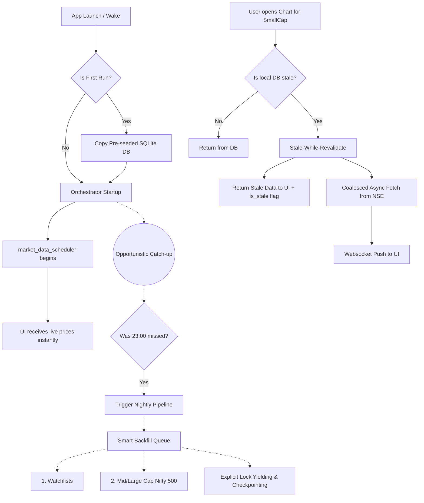

# Backend Background Tasks Redesign Plan (Desktop Conversion)

## 1. Overview
The BLM Terminal backend was originally designed for a 24/7 hosted server environment. In that model, a rigorous startup pipeline (managed by the central Orchestrator) pre-computed indicators, backfilled historical data, and scanned the entire market on boot before unlocking live data feeds. 

Transitioning to a Desktop Client (Electron + PyInstaller) requires a fundamental architectural pivot. Desktop applications prioritize immediate UI responsiveness over total background readiness. We must shift from an **Eager/Blocking** model to a **System Tray / Lazy-Trickle** model. The application will remain "warm" in the background, ship with a intelligently pre-seeded database, prioritize high-value stocks, and lazily fetch the rest on-demand without freezing the user interface.

## 2. Architecture Details & Visuals

### 2.1 The System Tray & Lifecycle Model
Instead of shutting down completely when the user closes the main window, the Electron app and FastAPI backend will minimize to the System Tray (background daemon mode). 
*   **The "Nightly" Solution:** Background cron jobs (like the 23:00 IST Nightly pipeline) can run reliably in the background without user intervention.
*   **Zero-Latency Launches:** Because the Node.js server and Python backend are kept alive in the background, clicking the system tray icon to open the terminal results in an instantaneous launch. (Auto-start on OS boot will be an **Opt-in** setting to respect user resources).
*   **Singleton Enforcement:** The Electron app will implement a single-instance lock. If a user double-clicks the desktop shortcut while the tray app is running, it will simply bring the existing hidden window to the front, preventing two FastAPI instances from fighting over the SQLite database lock.
*   **Graceful Shutdowns:** A "Quit" action from the tray will route a `SIGTERM` to the FastAPI backend, commanding background threads to instantly commit their current trickle-batch, update their checkpoint cursor, and exit safely to prevent SQLite Write-Ahead Log (WAL) corruption.

### 2.2 Proposed Data Architecture (Lazy + Smart Trickle)

## 3. Shift in Constraints & Limitations

### Old Limitations to REMOVE (Hosted Model):
*   **Global Pre-computation Guarantee:** We no longer need to pre-cache historical weekly/monthly candles, RSI/MACD indicators, and momentum scores for all 2,000+ NSE equities on the off-chance a user views them.
*   **Strict Linear Startup Gate:** Gating the live market data scheduler behind the completion of global backfills is completely removed.

### New Limitations to ADD & ENFORCE (Desktop Model):
*   **Instant UI Readiness & Offline Resilience:** The app must be instantly usable and degrade gracefully to cached local data if the internet is disconnected or slow (a common desktop laptop reality).
*   **SQLite Concurrency (WAL mode):** Bulk batch inserts starve the UI of write access. Background tasks must yield the lock explicitly so user actions (saving layouts, adding to watchlists) don't hang.
*   **Local Storage Hygiene:** To prevent the SQLite database from bloating to gigabytes over months of desktop use, aggressive pruning of intraday candles is now mandatory.
*   **Request Coalescing:** Opening multiple widgets (Chart + Screener) for the same stale stock must not trigger duplicate upstream API calls.
*   **Resumability (Checkpointing):** Background pipelines interrupted by laptop restarts or sleep must resume via database checkpoints, rather than restarting from zero.

## 4. Core Strategy

1.  **Trimmed Pre-seeded Shipping:** Ship a pre-populated SQLite database containing historical data *only* for the Nifty 500 and heavily-watched stocks. This shrinks the installer size while eliminating the massive "first run" CPU penalty. The long-tail of ~1,500 illiquid stocks will rely purely on Lazy Fetching.
2.  **Stale-Install Delta Cap:** If a user installs a version of the app where the seed database is over 7 days old, the backend will skip the background trickle-sync for those highly stale items to avoid CPU/Network thrashing. They will be forced into the Lazy Fetch pipeline to update only when explicitly viewed.
3.  **Smart Prioritized Backfill:** The background trickle pipeline will abandon scanning the entire market. It will exclusively process the User's Watchlists and the Nifty 500. 
4.  **Idle Throttling:** The application will respect laptop battery life. If the terminal window is hidden or unfocused for more than 15 minutes, live market polling will pause.
5.  **Stale-While-Revalidate (Lazy Fetch):** If a user views a stock that isn't actively maintained, the system serves local data immediately, fetches the delta asynchronously, and pushes the update to the UI.

## 5. Action Plan: In-Depth Architectural Modifications

### 5.1 Electron & Packaging Adjustments
*   **System Tray Integration:** Implement the tray module in the Electron main process. Modify the window close event to hide the window instead of quitting. Add a single-instance lock to prevent duplicate boots.
*   **Graceful Exit Lifecycle:** The explicit "Quit" context menu action will trigger a `SIGTERM` interceptor in the FastAPI lifespan, allowing the database to close safely.
*   **Opt-in OS Auto-start:** Provide a user settings toggle for "Start with Windows", keeping launch-on-demand as the default.

### 5.2 Orchestrator & Pipeline Redesign
*   **Sever the Market Data Gate:** Remove the blocking loops inside the market data scheduler that wait for the startup pipeline to finish. Live market fetching begins instantly upon app boot.
*   **Prune the Pipeline:** Remove heavy stages (weekly/monthly backfills and indicator computes) from the blocking startup pipeline entirely.
*   **Offline Resilience:** Wrap the Universe Sync stage in network exception handlers. If the user launches the app without internet, the backend logs a warning and proceeds using the pre-seeded universe rather than crashing.
*   **Opportunistic Nightly Trigger:** The orchestrator must check a "last nightly run" timestamp on cold boot and OS wake events. If the market is closed and it has been over 24 hours, it triggers the nightly pipeline as a low-priority background task.
*   **Data Pruning Stage:** Add a dedicated pipeline stage to delete 1m, 5m, and 15m intraday candles older than 30 days. When the UI is completely idle, execute a SQLite `VACUUM` to reclaim physical disk space.

### 5.3 Smart Daemon Adjustments
*   **Scope Reduction:** Background daemons must be rewritten to query distinct symbols from active watchlists and the Nifty 500, rather than the entire universe table.
*   **Boot Delay & Idle Pause:** Introduce a 30-second delay at the start of these daemon loops *only* on a cold process boot (giving the user uncontended UI interaction). Additionally, pause polling entirely if the Electron window is out of focus for over 15 minutes.

### 5.4 Checkpointing & Resumability (New Feature)
*   **State Persistence:** Create a new tracking table in SQLite (`sync_state`) storing the task name, last processed symbol, and updated timestamp.
*   **Resume Mechanics:** Before processing a batch, background tasks must read this cursor. After committing a batch, they update the cursor. If the task is aborted via `SIGTERM`, it resumes exactly where it left off on the next launch.

### 5.5 Stale-While-Revalidate & Request Coalescing (On-Demand Fetch)
*   **UI Fallback:** When the frontend requests data for a stale ticker, the backend immediately returns the local database data appended with an `is_stale: true` flag. The UI renders this instantly without a blocking loading spinner.
*   **Coalescing Registry:** Implement an in-flight request registry using an asynchronous dictionary of Futures, wrapped in a strict concurrency semaphore (e.g., max 5 upstream calls). If multiple widgets request the same stale stock, only one upstream API call is made.
*   **Async Refresh & Push:** Spawn a background task to fetch the missing delta data. Upon completion, emit a websocket event to the frontend instructing it to invalidate its cache and redraw.

### 5.6 DB Concurrency & Trickle Writes
*   **SQLite Timeout Enforcement:** Ensure connection strings explicitly declare a `?timeout=15` parameter so that readers and writers briefly wait for locks rather than instantly failing with a "database is locked" error.
*   **Batch Size Reduction:** Reduce the background writer batch size substantially (e.g., from 50 to 5-10 items) to prioritize UI lock fairness over bulk throughput speed.
*   **Thread-safe Lock Yielding:** For background writers running in dedicated OS threads (like the parallel indicator sync via `ThreadPoolExecutor`), introduce an explicit `time.sleep(0.05)` after each batch commit. This is absolutely safe because it runs in a separate thread, specifically yielding the SQLite WAL lock back to the primary FastAPI async event loop so UI-driven writes can execute freely.