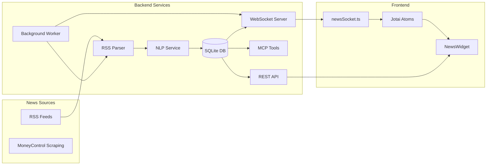
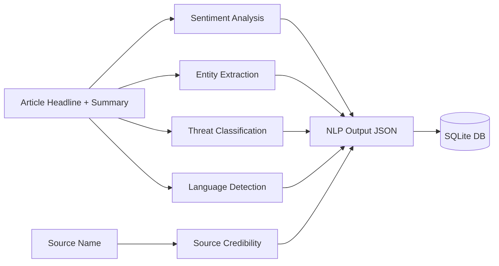
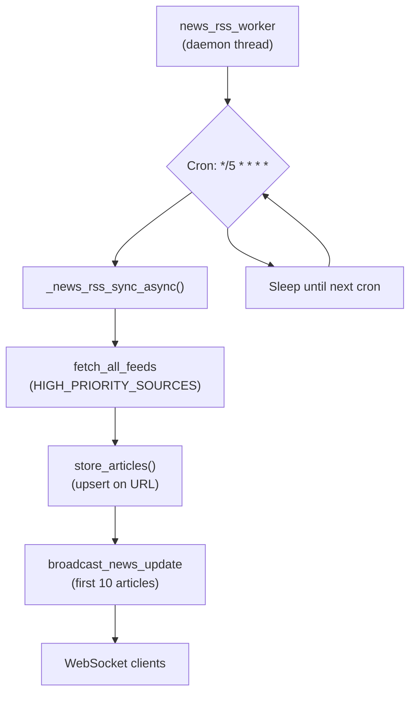
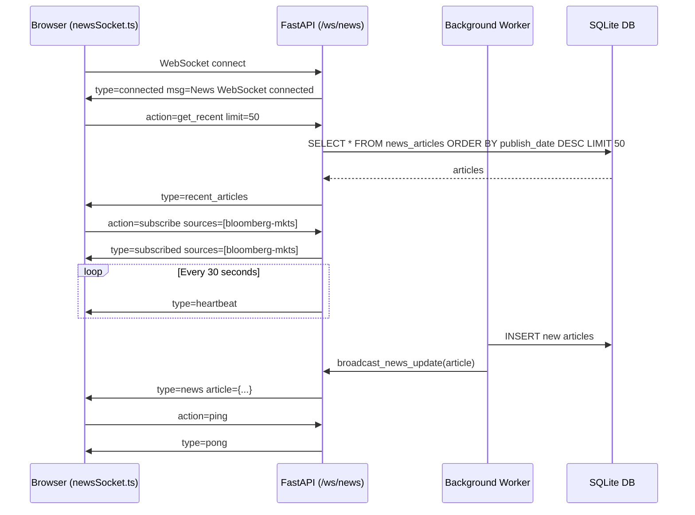

# Multi-Source News System - Implementation Report

**Project:** BLM Terminal Enhancement  
**Branch:** `feature/multi-source-news`  
**Last Updated:** 2026-05-27

---

## 1. Introduction

This document describes the complete implementation of the multi-source news system in BLM Terminal, which extends the single-source MoneyControl scraping pipeline with 35+ RSS feeds, NLP analysis, real-time WebSocket delivery, and enriched MCP tool access.

**What was built:**
- 35 RSS feed source definitions organized by tier and category
- Rule-based NLP pipeline (sentiment, entities, threat classification, language detection, source credibility)
- WebSocket endpoint at `/ws/news` for real-time article broadcasting
- Background RSS worker running every 5 minutes
- REST API endpoints for source listing, filtered aggregation, and on-demand analysis
- MCP tools (`get_global_news`, `get_company_news`) updated with full NLP fields and filter parameters
- Frontend `NewsWidget.tsx` enhanced with live article indicators, source filter chips, sentiment dots, threat badges, and pagination

---

## 2. System Architecture



**Data Flow:**
1. Background worker fetches all high-priority RSS feeds every 5 minutes
2. Each article is processed through the NLP pipeline (sentiment, entities, threat, language, credibility)
3. Articles are stored in SQLite with upsert (URL deduplication)
4. WebSocket broadcasts new articles to connected clients
5. Frontend receives articles in real-time via `newsSocket.ts`
6. REST API serves paginated filtered articles for initial load
7. MCP tools expose the same data to Claude Desktop

---

## 3. RSS News Sources

### 3.1 Source Organization

Sources are defined in `backend/app/services/news_sources.py` and organized by:
- **Tier**: TIER_1 (most trusted), TIER_2 (standard), TIER_3 (supplementary)
- **Category**: MARKETS, GEOPOLITICS, CRYPTO, TECH, REGULATORY, ECONOMIC
- **Country scope**: global, India-specific, or region-specific

### 3.2 Tier 1 — Wire & Regulatory (5 sources)

| ID | Name | URL | Category |
|---|---|---|---|
| `ap-top` | AP Top News | `rsshub.app/apnews/topics/ap-top-news` | GEOPOLITICS |
| `sec-press` | SEC Press Releases | `sec.gov/news/pressreleases.rss` | REGULATORY |
| `fed-press` | Federal Reserve | `federalreserve.gov/feeds/press_all.xml` | REGULATORY |
| `ecb-press` | ECB Press | `ecb.europa.eu/rss/press.html` | REGULATORY |
| `boe-news` | Bank of England | `bankofengland.co.uk/rss/news` | REGULATORY |

### 3.3 Tier 1 — Major Financial (3 sources)

| ID | Name | URL | Category |
|---|---|---|---|
| `bloomberg-mkts` | Bloomberg Markets | `feeds.bloomberg.com/markets/news.rss` | MARKETS |
| `wsj-markets` | WSJ Markets | `feeds.a.dj.com/rss/RSSMarketsMain.xml` | MARKETS |
| `cnbc-finance` | CNBC Finance | `search.cnbc.com/rs/.../view.xml` | MARKETS |

### 3.4 Tier 2 — India (4 sources)

| ID | Name | URL | Category |
|---|---|---|---|
| `moneycontrol` | MoneyControl | `moneycontrol.com/rss/latestnews.xml` | MARKETS |
| `et-markets` | Economic Times | `economictimes.indiatimes.com/rssfeedstopstories.cms` | MARKETS |
| `livemint` | LiveMint | `livemint.com/rss/markets` | MARKETS |
| `hindu-biz` | The Hindu Business | `thehindu.com/business/feeder/default.rss` | MARKETS |

### 3.5 Tier 2 — Global Markets (10 sources)

| ID | Name | URL | Category |
|---|---|---|---|
| `marketwatch` | MarketWatch | `feeds.marketwatch.com/marketwatch/topstories/` | MARKETS |
| `seekingalpha` | Seeking Alpha | `seekingalpha.com/market_currents.xml` | MARKETS |
| `investing-news` | Investing.com | `investing.com/rss/news.rss` | MARKETS |
| `benzinga` | Benzinga | `benzinga.com/feed` | MARKETS |
| `bbc-business` | BBC Business | `feeds.bbci.co.uk/news/business/rss.xml` | MARKETS |
| `nikkei-asia` | Nikkei Asia | `asia.nikkei.com/rss/feed/nar` | MARKETS |
| `cna` | Channel News Asia | `channelnewsasia.com/rssfeeds/8395986` | MARKETS |
| `economist` | The Economist | `economist.com/finance-and-economics/rss.xml` | ECONOMIC |
| `aljazeera` | Al Jazeera | `aljazeera.com/xml/rss/all.xml` | GEOPOLITICS |
| `foreignpolicy` | Foreign Policy | `foreignpolicy.com/feed/` | GEOPOLITICS |

### 3.6 Tier 2 — Crypto (3 sources)

| ID | Name | URL | Category |
|---|---|---|---|
| `coindesk` | CoinDesk | `coindesk.com/arc/outboundfeeds/rss/` | CRYPTO |
| `cointelegraph` | CoinTelegraph | `cointelegraph.com/rss` | CRYPTO |
| `theblock` | The Block | `theblock.co/rss.xml` | CRYPTO |

### 3.7 Tier 2 — Tech (4 sources)

| ID | Name | URL | Category |
|---|---|---|---|
| `techcrunch` | TechCrunch | `techcrunch.com/feed/` | TECH |
| `finextra` | Finextra | `finextra.com/rss/headlines.aspx` | TECH |
| `theverge` | The Verge | `theverge.com/rss/index.xml` | TECH |
| `arstechnica` | Ars Technica | `feeds.arstechnica.com/arstechnica/index` | TECH |

### 3.8 Tier 3 — Additional (6 sources)

| ID | Name | URL | Category |
|---|---|---|---|
| `bbc-world` | BBC World | `feeds.bbci.co.uk/news/world/rss.xml` | GEOPOLITICS |
| `calculated-risk` | Calculated Risk | `feeds.feedburner.com/CalculatedRisk` | ECONOMIC |
| `zero-hedge` | ZeroHedge | `feeds.feedburner.com/zerohedge/feed` | ECONOMIC |
| `bellingcat` | Bellingcat | `bellingcat.com/feed/` | GEOPOLITICS |
| `hackernews` | Hacker News | `hnrss.org/frontpage` | TECH |
| `abnormal-returns` | Abnormal Returns | `abnormalreturns.com/feed/` | MARKETS |

### 3.9 Source Priorities

- **`HIGH_PRIORITY_SOURCES`** (`news_sources.py:376`): Tier 1 + Tier 2 sources only (29 sources). Used by the background RSS worker.
- **`ALL_SOURCES`**: All 35+ sources including Tier 3.
- **Lookup dictionaries**: `SOURCES_BY_ID`, `SOURCES_BY_CATEGORY`, `SOURCES_BY_TIER` for programmatic access.

---

## 4. NLP Processing Pipeline



### 4.1 Sentiment Analysis

**File:** `backend/app/services/nlp_service.py`  
**Approach:** Weighted word-list matching (rule-based, no ML)

**Word Lists:**
- **POSITIVE_WORDS** with weights 1-3: 30+ words including `surge` (3), `soar` (3), `rally` (2), `gain` (2), `strong` (1), `bullish` (1)
- **NEGATIVE_WORDS** with weights 1-3: 35+ words including `crash` (3), `plunge` (3), `fall` (2), `recession` (2), `fear` (1), `bearish` (1)

**Scoring Algorithm:**
1. Combine headline + summary, lowercase
2. Sum positive word weights → `pos_score`
3. Sum negative word weights → `neg_score`
4. `total = pos_score + neg_score`
5. `net = pos_score - neg_score`
6. **BULLISH** if `net >= 2`, **BEARISH** if `net <= -2`, else **NEUTRAL**
7. Score = `net / max(total, 1)` (range -1.0 to 1.0)
8. Confidence = `min(0.4 + total * 0.05, 0.95)`

**Why rule-based?**
- Fast (no ML inference overhead)
- No external NLP library dependencies
- Headlines are typically straightforward — context/sarcasm detection is less critical
- Same approach proven in FinceptTerminal's C++ implementation

### 4.2 Entity Extraction

**Types extracted:** Countries, Organizations, People, Tickers

**Countries** (`_extract_countries`): 49 name-to-code mappings
- Maps common names and cities to ISO codes: `"united states"→US`, `"moscow"→RU`, `"beijing"→CN`, `"london"→GB`
- Returns up to 5 unique country codes

**Organizations** (`_extract_organizations`): 38 name mappings
- `"nato"→"NATO"`, `"imf"→"IMF"`, `"federal reserve"→"Federal Reserve"`, `"sec"→"SEC"`, `"apple"→"Apple"`, `"nvidia"→"NVIDIA"`, `"google"→"Google"`, etc.
- Returns up to 5 unique organizations

**People** (two methods):
1. **Known persons** (`_known_persons`): 33 name mappings — `"biden"→"Joe Biden"`, `"putin"→"Vladimir Putin"`, `"modi"→"Narendra Modi"`, `"musk"→"Elon Musk"`
2. **Title-based extraction** (`_extract_persons_from_text`): Regex patterns for titles — `president`, `prime minister`, `chancellor`, `king`, `queen`, `ceo`, `cfo`, `chairman`, `director`, `minister`, `secretary`, `governor`, `general` followed by capitalized names
- Plus honorifics: `Mr`, `Mrs`, `Ms`, `Dr`, `Prof` followed by names
- Returns up to 5 people total (known + extracted, deduplicated)

**Tickers** (`_extract_tickers`):
- Regex: `\b[A-Z]{2,5}\b`
- **False-positive filter**: 67-word blocklist including `THE`, `FOR`, `AND`, `BUT`, `NOT`, `FROM`, `CEO`, `CFO`, `IPO`, `ETF`, `CPI`, `GDP`, `OIL`, `USD`, `YES`, `NEW`, `ONE`, `NOW`, `SEE`, `BUY`, `DAY`, `MAY`, `USE`, `OLD`, `WAY`, `FED`, `BIG`, `GOOD`, `BEST`, `HOME`, `MADE`, `JUST`, `EVEN`, `MORE`, `LONG`, `LAST`, `BACK`, `VERY`, `OVER`, `ALSO`, `BOTH`, `CARE`, `HERE`, `LIFE`, `PART`, `SAME`, `SURE`, `TAKE`, `THAN`, `THEY`, `WELL`, `WORK`, `AFTER`, `AGAIN`, `BEEN`, `COME`, `DOES`, `DONE`, `DOWN`, `EACH`, `FIND`, `FIRST`, `FOUR`, `FROM`, `GIVE`, `GROW`, `HAVE`, `HELD`, `HOLD`, `INTO`, `KNOW`, `LEFT`, `LIKE`, `LIVE`, `LOOK`, `MADE`, `MOST`, `MOVE`, `MUCH`, `MUST`, `NEED`, `NEXT`, `ONLY`, `OPEN`, `OURS`, `SALE`, `SAYS`, `SEEN`, `SELL`, `SHOW`, `SOME`, `STOP`, `SUCH`, `TAKE`, `TELL`, `THAN`, `THAT`, `THEM`, `THEN`, `THIN`, `THIS`, `TIME`, `VERY`, `WANT`, `WELL`, `WERE`, `WHAT`, `WHEN`, `WITH`, `YOUR`, `KEEP`, `GAIN`, `LOSS`, `RISK`, `RATE`
- Returns up to 5 tickers

**Max entities per type:** 5 each (countries, organizations, people, tickers)

### 4.3 Threat Classification

**File:** `backend/app/services/nlp_service.py`  
**Approach:** Keyword pattern matching with confidence thresholds

**CRITICAL level** (confidence 0.95):
- `nuclear strike` / `nuclear attack` → conflict
- `war declared` → conflict
- `market crash` / `flash crash` → market
- `circuit breaker` / `bank run` / `sovereign default` → market
- `cyberattack` / `data breach` / `ransomware` → cyber

**HIGH level** (confidence 0.8):
- `invasion` / `airstrike` / `missile launch` / `military deployment` / `coup attempt` / `martial law` → conflict
- `bankruptcy filing` / `rate hike` / `rate cut` / `earnings miss` / `profit warning` / `downgrade` → market
- `sanction` / `embargo` → regulatory
- `earthquake` / `tsunami` / `hurricane` / `pandemic` → natural

**MEDIUM level** (confidence 0.6):
- `protest` / `riot` / `tension` / `escalat` → conflict
- `tariff` / `regulation` / `antitrust` / `investigation` → regulatory
- `layoff` / `recession` / `inflation` / `selloff` / `volatil` → market
- `wildfire` / `flood` → natural

**LOW level** (default, confidence 0.3): category = `general`

**Threat categories:** `conflict`, `market`, `cyber`, `natural`, `regulatory`, `general`

### 4.4 Language Detection

**Approach:** Unicode character range detection (regex-based)

| Regex Range | Language | Code |
|---|---|---|
| `\u4e00-\u9fff` | Chinese | `zh` |
| `\u3040-\u309f\u30a0-\u30ff` | Japanese | `ja` |
| `\uac00-\ud7af` | Korean | `ko` |
| `\u0400-\u04ff` | Russian (Cyrillic) | `ru` |
| `\u0600-\u06ff` | Arabic | `ar` |
| `\u0900-\u097f` | Hindi (Devanagari) | `hi` |
| default (none match) | English | `en` |

### 4.5 Source Credibility

**STATE_MEDIA_SOURCES** (10 sources flagged):
`XINHUA`, `CGTN`, `GLOBAL TIMES`, `RT`, `TASS`, `SPUTNIK`, `PRESS TV`, `KCNA`, `TRT WORLD`, `AL ARABIYA`

**CAUTION_SOURCES** (4 sources flagged):
`ZEROHEDGE`, `INFOWARS`, `DAILY MAIL`, `NY POST`

**Result:**
- `STATE_MEDIA` for state media
- `CAUTION` for flagged caution sources
- `NONE` for all other sources

---

## 5. Database Schema

### 5.1 Migration

**File:** `backend/alembic/versions/x123456789newsnlp_add_news_nlp_fields.py`

**Columns added to `news_articles` table:**

| Column | Type | Nullable | Index |
|---|---|---|---|
| `sentiment` | `String(16)` | YES | `ix_news_articles_sentiment` |
| `sentiment_score` | `Float` | YES | — |
| `confidence` | `Float` | YES | — |
| `language` | `String(8)` | YES | — |
| `entities` | `JSON` | YES | — |
| `threat_level` | `String(16)` | YES | `ix_news_articles_threat_level` |
| `threat_category` | `String(32)` | YES | — |
| `source_credibility` | `String(16)` | YES | — |

**Idempotent:** Uses `_add_col_if_not_exists` wrapper to catch "duplicate column name" SQLite errors.

### 5.2 Model (`backend/app/models/news.py`)

```python
# Sentiment analysis
sentiment: Mapped[str | None]          # "BULLISH", "BEARISH", "NEUTRAL"
sentiment_score: Mapped[float | None]  # -1.0 to 1.0
confidence: Mapped[float | None]       # 0.0 to 1.0

# Language detection
language: Mapped[str | None]           # "en", "zh", "ja", "ko", "ru", "ar", "hi"

# Entity extraction
entities: Mapped[dict | None]          # {"countries": [], "organizations": [], "people": [], "tickers": []}

# Threat classification
threat_level: Mapped[str | None]       # "CRITICAL", "HIGH", "MEDIUM", "LOW"
threat_category: Mapped[str | None]    # "conflict", "market", "cyber", "natural", "regulatory", "general"

# Source credibility
source_credibility: Mapped[str | None]  # "STATE_MEDIA", "CAUTION", "NONE"
```

**Indexes:**
- `ix_news_articles_source_publish` on `(source, publish_date)`
- `ix_news_articles_sentiment` on `sentiment`
- `ix_news_articles_threat_level` on `threat_level`

---

## 6. RSS Worker & Background Tasks



### 6.1 Worker Configuration

**File:** `backend/app/backgroundtasks.py`  
**Cron schedule:** `*/5 * * * *` (every 5 minutes) — `NEWS_RSS_CRON` at line 1417  
**Job key:** `job.news_rss` — tracked via job status system  
**Startup behavior:** Runs immediately on thread start (no wait for stock universe)

### 6.2 Sync vs Async Sync Functions

**`_news_rss_sync()` (lines 1420–1465)** — Synchronous
- Called in worker threads with `asyncio.ensure_future(broadcast_news_update(...))` for WebSocket broadcast
- Uses `_run_async()` to call async `fetch_all_feeds()` from sync context
- Stores via `_SyncSessionLocal()` with `sqlite_insert().on_conflict_do_nothing(index_elements=["url"])`
- Broadcasts first 10 articles after storing

**`_news_rss_sync_async()` (lines 1468–1498)** — Asynchronous
- True async using `await fetch_all_feeds(...)`
- Stores via `_ThreadAsyncSessionLocal()` with `store_articles()`
- Direct `await broadcast_news_update(article_dict)` for first 10 articles
- Used by `news_rss_worker` which wraps calls in `_run_async()`

### 6.3 Broadcast Integration

After each sync cycle, the 10 most recent articles are broadcast via WebSocket:

| Location | Function Called | Context |
|---|---|---|
| `_news_rss_sync()` (lines 1452–1458) | `asyncio.ensure_future(broadcast_news_update(article_dict))` | Sync thread → schedules coroutine |
| `_news_rss_sync_async()` (lines 1491–1495) | `await broadcast_news_update(article_dict)` | Async context → direct await |

---

## 7. WebSocket System



### 7.1 Connection Manager

**File:** `backend/app/routers/news_ws.py`  
**Class:** `NewsConnectionManager` (lines 23–61)

| Method | Lines | Purpose |
|---|---|---|
| `connect(websocket)` | 29–32 | Accepts connection, adds to `active_connections` set |
| `disconnect(websocket)` | 34–36 | Removes from set via `discard()` |
| `broadcast(message)` | 38–53 | Iterates all connections, sends JSON, removes disconnected clients |
| `send_personal(websocket, message)` | 55–61 | Sends to specific client with error handling |

### 7.2 Message Types

**Server → Client:**

| Type | Payload | Trigger |
|---|---|---|
| `connected` | `{message: "..."}` | On client connect |
| `news` | `{article: {...}}` | New article from background worker |
| `recent_articles` | `{articles: [...]}` | Response to `get_recent` action |
| `subscribed` | `{sources: [...]}` | Confirmation of `subscribe` action |
| `heartbeat` | `{}` | Every 30 seconds (keep-alive) |
| `pong` | `{}` | Response to client `ping` |

**Client → Server:**

| Action | Payload | Purpose |
|---|---|---|
| `ping` | `{}` | Keep-alive check |
| `subscribe` | `{sources: [...]}` | Acknowledged but not actively filtering (placeholder) |
| `get_recent` | `{limit: N}` | Request recent articles from DB |

### 7.3 Broadcast Function

**Function:** `broadcast_news_update(article: dict)` (lines 180–188)  
**Called by:** `_news_rss_sync()` and `_news_rss_sync_async()` in `backgroundtasks.py`  
**Purpose:** Wraps article in `{"type": "news", "article": ...}` envelope and broadcasts to all active connections

---

## 8. REST API Endpoints

**Router:** `backend/app/routers/news.py` (mounted at `/api/news`)

### 8.1 `GET /news/sources`

**Purpose:** List all configured RSS news sources  
**Query params:**
- `category` — filter by category string (e.g., `"MARKETS"`, `"GEOPOLITICS"`)
- `tier` — filter by tier number (1, 2, or 3)

**Response:** `NewsSourcesOut` — list of `NewsSourceOut` objects with `id`, `name`, `category`, `tier`, `description` and `total` count.

### 8.2 `GET /news/all`

**Purpose:** Paginated aggregated news from all RSS sources with multi-dimensional filtering  
**Query params:**
- `sources` — comma-separated source IDs
- `categories` — comma-separated categories
- `sentiment` — `"BULLISH"`, `"BEARISH"`, or `"NEUTRAL"`
- `threat_level` — `"CRITICAL"`, `"HIGH"`, `"MEDIUM"`, or `"LOW"`
- `language` — two-letter code (e.g., `"en"`, `"zh"`)
- `start_date` / `end_date` — datetime range
- `limit` — page size (default 50, max 100)
- `offset` — pagination offset

**Response:** `NewsPaginatedOut` — articles + pagination metadata

### 8.3 `POST /news/analyze`

**Purpose:** On-demand NLP analysis without storing anything  
**Body:** `AnalyzeTextRequest` — `{headline: string, summary: string}`  
**Response:** `AnalyzeTextOut` — all NLP fields (sentiment, score, confidence, language, entities, threat_level, threat_category, source_credibility)

---

## 9. MCP Tools

**File:** `backend/app/mcp_server.py`  
**Protocol:** FastMCP (FastAPI-mounted MCP server)  
**Bundle proxy:** `blm-mcp-bundle/server/index.js` — translates MCP stdio → HTTP JSON-RPC → Python backend

### 9.1 `get_global_news`

**Function:** `get_global_news()` — lines 1079–1147 in `mcp_server.py`

**New parameters added:**

| Parameter | Type | Default | Description |
|---|---|---|---|
| `sources` | `list[str]` | `None` | Filter by source IDs |
| `sentiment` | `str` | `None` | `"POSITIVE"`, `"NEGATIVE"`, `"NEUTRAL"` |
| `threat_level` | `str` | `None` | `"LOW"`, `"MEDIUM"`, `"HIGH"`, `"CRITICAL"` |
| `language` | `str` | `None` | Two-letter code (e.g., `"en"`, `"zh"`) |

**Key change:** Removed `NewsArticle.source == SOURCE_NAME` filter. Now returns articles from **all sources** (MoneyControl + all RSS feeds).

**Filter logic:** OR/additive — an article passes if it matches **any** active filter (date filter is always AND, additional filters are OR'd together).

**Returned fields:** All original fields (`url`, `title`, `text`, `publish_date`, `fetched_at`) plus all NLP fields (`sentiment`, `sentiment_score`, `confidence`, `language`, `entities`, `threat_level`, `threat_category`, `source_credibility`).

### 9.2 `get_company_news`

**Function:** `get_company_news()` — lines 1153–1284 in `mcp_server.py`

**New parameters added:**

| Parameter | Type | Default | Description |
|---|---|---|---|
| `sentiment` | `str` | `None` | `"POSITIVE"`, `"NEGATIVE"`, `"NEUTRAL"` |
| `threat_level` | `str` | `None` | `"LOW"`, `"MEDIUM"`, `"HIGH"`, `"CRITICAL"` |
| `language` | `str` | `None` | Two-letter code |

**Returned fields:** Same as `get_global_news` — all original + all NLP fields.

**Filter logic:** Same OR/additive approach within the company symbol scope.

**Caching:** 30-minute stale threshold (`_COMPANY_NEWS_STALE_SECONDS = 1800`). `refresh=True` forces live MoneyControl fetch.

### 9.3 Bundle Manifest Updates

**File:** `blm-mcp-bundle/manifest.json`

Updated descriptions for news tools to reflect NLP capabilities:
- `get_global_news`: "Fetch recent financial news from MoneyControl and 35+ RSS sources with NLP sentiment analysis, threat classification, and entity extraction. Supports filtering by source, sentiment, threat level, and language."
- `get_company_news`: "Fetch news articles for an NSE company with NLP sentiment, threat level, entity extraction, and source credibility ratings. Supports filtering by sentiment, threat level, and language."

---

## 10. Frontend Implementation

### 10.1 WebSocket Client

**File:** `src/lib/newsSocket.ts`

**Class:** `NewsWebSocketService` — singleton pattern

**Public API:**

| Method | Description |
|---|---|
| `connect()` | Opens WebSocket, starts reconnection logic |
| `disconnect()` | Closes socket, clears timers |
| `subscribe(sources: string[])` | Sends subscription to server |
| `getRecent(limit = 20)` | Requests recent articles |
| `onNews(handler)` | Subscribe to live article events; returns unsubscribe fn |
| `onConnectionChange(handler)` | Subscribe to connection status; returns unsubscribe fn |
| `isConnected` (getter) | Current connection state |
| `recentArticles` (getter) | Cached recent articles array (max 100) |

**Reconnection:** Exponential backoff — `delay = min(1000 * 2^attempts, 30000ms)`, max 10 attempts.

**Message handling:**
- `connected` → logs server greeting
- `news` → prepends to `_recentArticles` (max 100, dedup by URL), notifies `newsListeners`
- `recent_articles` → replaces `_recentArticles`
- `subscribed` → updates `subscribedSources` set
- `heartbeat` / `pong` → no-op

### 10.2 State Management

**File:** `src/store/terminalStore.ts`

**New atoms:**

| Atom | Type | Default | Persistence |
|---|---|---|---|
| `newsWsConnectedAtom` | `boolean` | `false` | No (transient) |
| `liveNewsArticlesAtom` | `NewsArticle[]` | `[]` | No (transient) |
| `newsFiltersAtom` | `NewsFilters` | `{sources: [], sentiment: null, threatLevel: null}` | `sessionStorage` (key: `news.filters`) |

### 10.3 NewsWidget

**File:** `src/components/widgets/NewsWidget.tsx`

**Tab structure:**
- **Global tab** — source filter chips, live articles section, paginated DB articles
- **Company tab** — symbol-specific news with manual refresh button

**New UI features:**

| Feature | Implementation |
|---|---|
| **Source filter chips** | Toggleable chips for all 12 labeled sources (`SOURCE_LABELS` map), multi-select, "Clear" button |
| **Sentiment dots** | Colored circles (green/red/gray) with opacity scaled to `sentiment_score` (0.3–1.0), 2px diameter |
| **Threat badges** | `LOW`/`MED`/`HIGH`/`CRIT` with color-coded backgrounds (`bg-green-900` through `bg-red-900`) |
| **Credibility warning** | Yellow ⚠ icon for `source_credibility` = `low` or `caution` |
| **Live section** | Green animated ping dot + "LIVE" header, shows up to 5 most recent WebSocket articles above DB results (Global tab only) |
| **Pagination** | `Prev`/`Next` buttons with `PAGE_LIMIT = 50`, offset arithmetic, total count display |

**WebSocket integration:**
- Calls `newsSocketService.connect()` on mount
- Subscribes to connection changes → updates `newsWsConnectedAtom`
- On connection → calls `newsSocketService.getRecent(50)`
- Subscribes to news events → appends to `liveNewsArticlesAtom` (dedup by URL, max 100)
- Live articles filtered by `newsFiltersAtom` criteria (sources, sentiment, threat)

**REST API integration:**
- `useQuery` for `news/global` with `{limit, offset}`
- `useQuery` for `news/company` with symbol + pagination
- Company tab: GET first, POST fallback on 404 (triggers async fetch)

---

## 11. Testing

### 11.1 Unit Tests — Backend

| File | Tests | Coverage |
|---|---|---|
| `backend/tests/test_news_sources.py` | 15 | Source definitions, tier/category enums, lookup functions |
| `backend/tests/test_nlp_service.py` | 35 | Sentiment, threat, credibility, language, entities, full analysis |

**Total:** 50 tests passing

**Key test categories:**
- Sentiment: bullish, bearish, neutral, confidence, empty text
- Threat: critical (nuclear, market crash), high (invasion, rate hike), medium (protest, recession), low (default)
- Credibility: state media (Xinhua, RT, CGTN), caution (ZeroHedge, Infowars), normal
- Language: English, Chinese, Japanese, Korean, Russian, Arabic, Hindi
- Entities: countries, organizations, people, tickers (with false positive filtering)

### 11.2 MCP Tests

**File:** `backend/tests/test_mcp.py`

**Updated tests for news tools:**

| Test Class | Tests |
|---|---|
| `TestMCPCompanyNews` | `test_response_includes_nlp_fields` |
| `TestMCPGlobalNews` | `test_returns_list`, `test_response_includes_nlp_fields`, `test_filter_by_sentiment`, `test_filter_by_source`, `test_filter_by_threat_level`, `test_filter_by_language` |

**Note:** MCP tests require the backend server running (port 4455). They are integration tests, not pure unit tests.

### 11.3 Frontend Tests

No new frontend tests were added for this feature. Existing test suite passes.

---

## 12. File Index

### New Files (8)

| File | Lines | Purpose |
|---|---|---|
| `backend/app/services/news_sources.py` | ~390 | 35+ RSS feed definitions with tier/category system |
| `backend/app/services/rss_parser.py` | ~200 | RSS parsing with feedparser, concurrent fetching |
| `backend/app/services/nlp_service.py` | ~350 | NLP pipeline (sentiment, entities, threat, language, credibility) |
| `backend/app/services/news_aggregator.py` | ~280 | Orchestration layer combining RSS + NLP + DB storage |
| `backend/app/routers/news_ws.py` | ~188 | WebSocket endpoint at `/ws/news` |
| `src/lib/newsSocket.ts` | ~199 | News WebSocket client (singleton, reconnection, events) |
| `backend/alembic/versions/x123456789newsnlp_add_news_nlp_fields.py` | ~95 | Alembic migration adding 8 NLP columns |
| `docs/multi-source-news/IMPLEMENTATION.md` | ~750 | This document |

### Modified Files (12)

| File | Key Changes |
|---|---|
| `backend/app/models/news.py` | Added 8 NLP fields + indexes |
| `backend/app/schemas/news.py` | Added `NewsArticleOut` (with NLP), `NewsSourceOut`, `NewsSourcesOut`, `AnalyzeTextRequest`, `AnalyzeTextOut`, `FetchResultOut`, `FetchAllOut` |
| `backend/app/routers/news.py` | Added `GET /news/sources`, `GET /news/all`, `POST /news/analyze` |
| `backend/app/routers/__init__.py` | Exported `news_ws_router` |
| `backend/main.py` | Mounted `news_ws_router` at `/ws/news` (line 432) |
| `backend/app/backgroundtasks.py` | Added `news_rss_worker` (cron: `*/5 * * * *`), `_news_rss_sync`, `_news_rss_sync_async`, WebSocket broadcast integration |
| `backend/app/mcp_server.py` | `get_global_news` (lines 1079–1147): removed source filter, added NLP fields + 4 filter params. `get_company_news` (lines 1153–1284): added NLP fields + 3 filter params |
| `blm-mcp-bundle/manifest.json` | Updated `get_global_news` and `get_company_news` descriptions |
| `src/store/terminalStore.ts` | Added `newsWsConnectedAtom`, `liveNewsArticlesAtom`, `newsFiltersAtom` |
| `src/components/widgets/NewsWidget.tsx` | Full rewrite with source chips, sentiment dots, threat badges, credibility warning, live section, pagination |
| `backend/pyproject.toml` | Added `feedparser` dependency |
| `backend/tests/test_mcp.py` | Added NLP field verification tests and filter tests for news tools |

---

## 13. Deployment Notes

### 13.1 Prerequisites

```bash
# Backend
cd backend
source .venv/bin/activate
pip install -e ".[dev]"

# Frontend
cd ..
npm install
```

### 13.2 Database Migration

```bash
cd backend
alembic upgrade head
```

### 13.3 Start Backend

```bash
cd backend
uvicorn main:app --reload --port 4455
```

### 13.4 Start Frontend

```bash
npm run dev
```

### 13.5 Verify WebSocket

Connect to `ws://localhost:4455/ws/news` via browser console:
```javascript
const ws = new WebSocket('ws://localhost:4455/ws/news');
ws.onmessage = (e) => console.log(JSON.parse(e.data));
```

---

## 14. Known Limitations

1. **Subscription filtering not yet active** — The `subscribe` action in the WebSocket endpoint is acknowledged but does not actually filter articles. Articles are broadcast to all connected clients unconditionally.
2. **Tier 3 sources not fetched by background worker** — `HIGH_PRIORITY_SOURCES` excludes Tier 3 (6 sources). They are available via direct API calls but not auto-fetched every 5 minutes.
3. **NLP for existing articles** — Only new articles fetched after deployment get NLP fields. Existing articles in the database remain without NLP data.
4. **MCP tests require running server** — `test_mcp.py` integration tests need the FastAPI server on port 4455.

---

## 15. References

- **FinceptTerminal reference:** `~/Documents/FinceptTerminal` — 80+ RSS feeds, C++ news system, Python NLP scripts
- **BLM Terminal AGENTS.md:** `AGENTS.md` — project conventions and build instructions
- **Branch:** `feature/multi-source-news`
