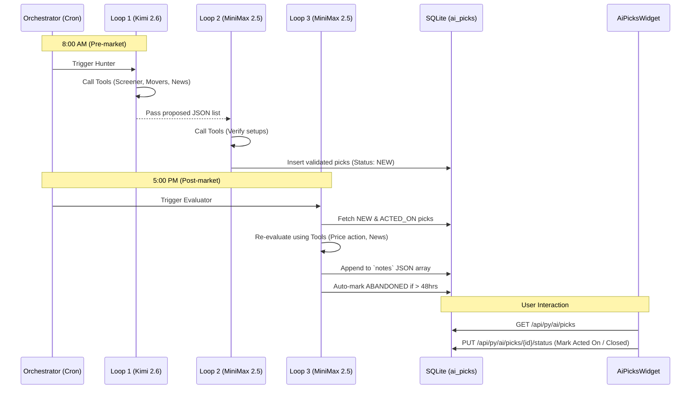

# AI Picks Feature - Execution Plan

This document outlines the step-by-step execution plan for implementing the AI Picks feature.

## Architecture Flow



## Step 1: Database Setup

**1. Create Model File**
Path: `backend/app/models/ai_picks.py`
```python
import enum
from datetime import datetime
from sqlalchemy import Column, Integer, String, Enum, Float, JSON, DateTime
from app.database import Base

class PickStatus(str, enum.Enum):
    NEW = "NEW"
    ACTED_ON = "ACTED_ON"
    CLOSED = "CLOSED"
    ABANDONED = "ABANDONED"

class PickDirection(str, enum.Enum):
    LONG = "LONG"
    SHORT = "SHORT"

class AIPick(Base):
    __tablename__ = "ai_picks"

    id = Column(Integer, primary_key=True, index=True)
    symbol = Column(String, index=True, nullable=False)
    exchange = Column(String, default="NSE", nullable=False)
    status = Column(Enum(PickStatus), default=PickStatus.NEW, nullable=False)
    direction = Column(Enum(PickDirection), nullable=False)
    
    entry_price = Column(Float, nullable=False)
    take_profit = Column(Float, nullable=False)
    stop_loss = Column(Float, nullable=False)
    notes = Column(JSON, default=list, nullable=False)
    
    created_at = Column(DateTime, default=datetime.utcnow, nullable=False)
    updated_at = Column(DateTime, default=datetime.utcnow, onupdate=datetime.utcnow, nullable=False)
```

**2. Ensure model is loaded in `backend/app/models/__init__.py`**
```python
from .ai_picks import AIPick
```

**3. Run Migration**
```bash
cd backend
alembic revision --autogenerate -m "add ai_picks table"
alembic upgrade head
```

## Step 2: MCP Tool Expansion

**1. Update `backend/app/mcp_server.py`**
Add the Announcements wrapper so the AI loops can see upcoming board meetings.

```python
from app.routers.announcements import get_event_calendar_cached
from datetime import datetime

async def get_upcoming_events(symbol: str) -> dict:
    try:
        events = get_event_calendar_cached()
        symbol_upper = symbol.upper()
        filtered = [
            e for e in events 
            if e.symbol == symbol_upper 
            and datetime.strptime(e.date, "%d-%b-%Y") >= datetime.now()
        ]
        return {"events": [e.model_dump() for e in filtered]}
    except Exception as e:
        return {"error": str(e)}

# Add to BLM_TOOLS
{
    "type": "function",
    "function": {
        "name": "get_upcoming_events",
        "description": "Get upcoming board meetings and corporate events for a specific ticker symbol.",
        "parameters": {
            "type": "object",
            "properties": {"symbol": {"type": "string"}},
            "required": ["symbol"]
        }
    }
}
```

## Step 3: API Router Implementation

**1. Create Router**
Path: `backend/app/routers/ai_picks.py`
```python
from fastapi import APIRouter, Depends, HTTPException
from sqlalchemy.ext.asyncio import AsyncSession
from sqlalchemy import select
from app.database import get_db
from app.models.ai_picks import AIPick, PickStatus

router = APIRouter()

@router.get("/picks")
async def get_all_picks(status: PickStatus | None = None, db: AsyncSession = Depends(get_db)):
    query = select(AIPick).order_by(AIPick.updated_at.desc())
    if status:
        query = query.where(AIPick.status == status)
    result = await db.execute(query)
    return result.scalars().all()

@router.put("/picks/{pick_id}/status")
async def update_pick_status(pick_id: int, new_status: PickStatus, db: AsyncSession = Depends(get_db)):
    result = await db.execute(select(AIPick).where(AIPick.id == pick_id))
    pick = result.scalar_one_or_none()
    if not pick:
        raise HTTPException(status_code=404, detail="Pick not found")
    pick.status = new_status
    await db.commit()
    return pick
```

**2. Register Router in `backend/main.py`**
```python
from app.routers import ai_picks
app.include_router(ai_picks.router, prefix="/ai", tags=["ai"])
```

## Step 4: AI Daemon Workers

**1. Create Worker**
Path: `backend/app/workers/ai_picks_worker.py`
This file will contain `run_loop_1_and_2()` (Triggered at 8 AM) and `run_loop_3()` (Triggered at 5 PM). Both will use standard OpenAI/Anthropic SDKs or `httpx` to ping OpenCode Zen using the tools defined in Step 2.

**2. Register in `backend/app/orchestrator.py`**
Import `ai_picks_daemon` from `ai_picks_worker` and add it to the background tasks loop inside `_runtime.py` or the orchestrator's main startup thread list.

## Step 5: Frontend Widget

**1. Create Widget Component**
Path: `src/components/widgets/AiPicksWidget.tsx`
(See Implementation doc for full Tanstack Query and JSX React code).

**2. Register Widget**
- `src/components/Panel.tsx`: Add `import { AiPicksWidget }` and `case 'PICKS': return <AiPicksWidget />;`
- `src/components/TerminalContainer.tsx`: Add `'PICKS'` to `VALID_WIDGETS`.
- `src/components/CommandBar.tsx`: Add `{ cmd: 'PICKS', desc: 'AI Swing Trade Picks' }` to `WIDGET_COMMANDS`.
- `src/store/terminalStore.ts`: (Optional) Add to `DEFAULT_ACTIVE_PANELS`.
