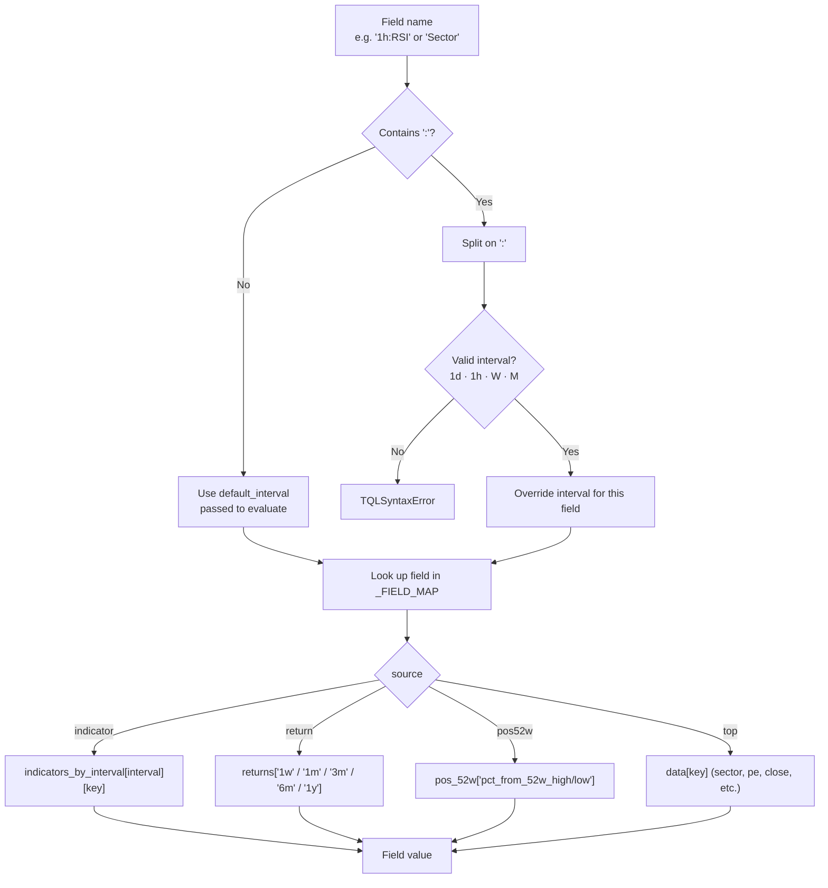
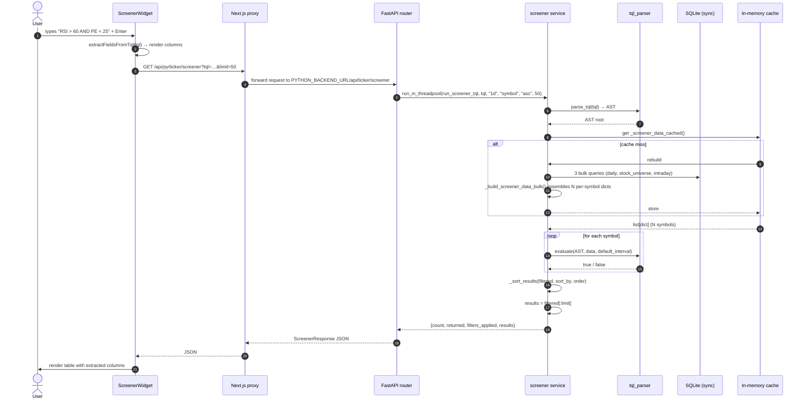
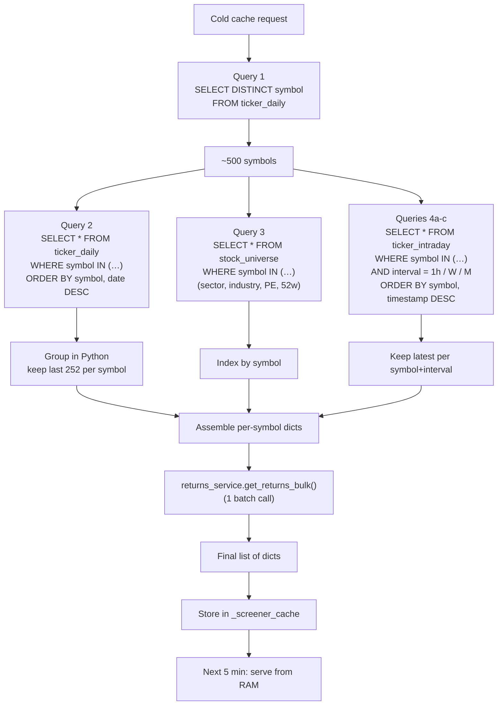
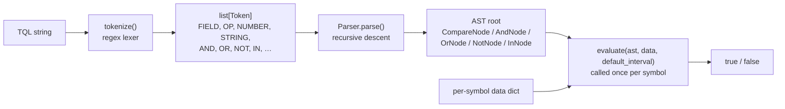
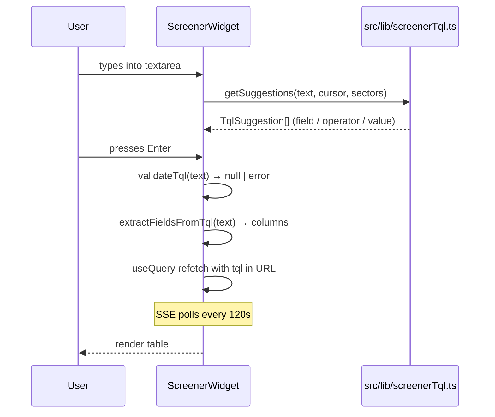
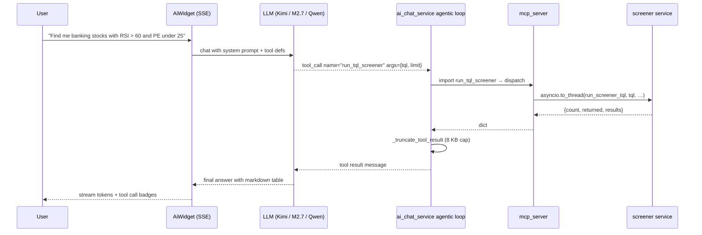
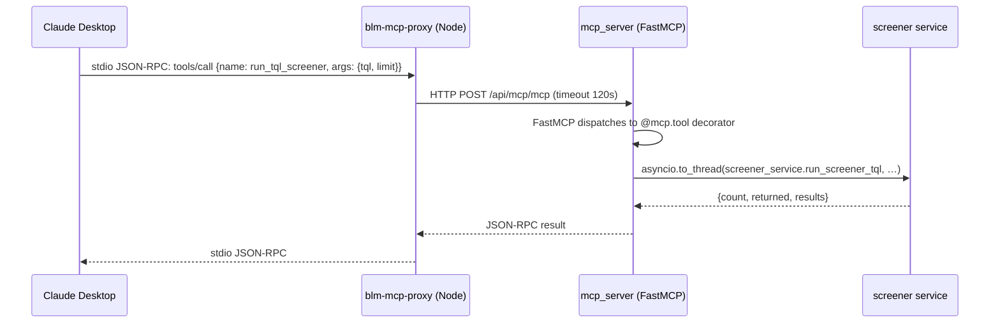

# Screener & TQL Engine

This document explains how the **screener** subsystem works end-to-end — from the user typing a TQL query in the `ScreenerWidget`, through the Next.js proxy, into the FastAPI backend, through the TQL parser/evaluator, against the bulk-loaded SQLite data warehouse, and back to the rendered result table.

It also documents how the same engine is exposed to the **AI chat agent** and the **MCP bundle** as the `run_tql_screener` tool.

---

## 1. Architecture at a Glance

The screener is a single-purpose, read-only query engine that runs over a cached in-memory snapshot of the NSE stock universe. Three entry points share the same underlying engine:

| Entry point | Caller | Path / tool |
|---|---|---|
| **Widget** | `ScreenerWidget.tsx` (Next.js) | `GET /api/py/ticker/screener?tql=…` |
| **AI chat** | `ai_chat_service.py` agentic loop | `run_tql_screener(tql, default_interval, sort_by, order, limit)` |
| **MCP server** | Claude Desktop via `blm-mcp-proxy` | MCP `tools/call` → `run_tql_screener` |

```mermaid
flowchart LR
    subgraph Client["Client"]
        W[ScreenerWidget.tsx]
        A[AiWidget / Claude Desktop]
    end

    subgraph Edge["Next.js edge"]
        P["/api/py/[...path]/route.ts<br/>catch-all proxy"]
    end

    subgraph Backend["FastAPI :4455"]
        R["routers/ticker.py<br/>GET /api/ticker/screener"]
        S["services/screener.py<br/>run_screener_tql()"]
        T["services/tql_parser.py<br/>parse_tql() + evaluate()"]
        M["mcp_server.py<br/>@mcp.tool run_tql_screener"]
    end

    subgraph Data["Data layer"]
        DB[("SQLite<br/>ticker_daily · ticker_intraday · stock_universe")]
        CACHE[("In-memory cache<br/>5-min TTL")]
    end

    W -->|fetch| P
    A -->|MCP JSON-RPC| M
    P -->|HTTP| R
    M -->|asyncio.to_thread| S
    R -->|run_in_threadpool| S
    S -->|parse + evaluate| T
    S -->|bulk load| DB
    S <-->|read/write| CACHE
    S -->|return (count, results)| R
    S -->|return dict| M
    R -->|JSON| P
    M -->|JSON-RPC| A
    P -->|JSON| W
```

---

## 2. TQL (Ticker Query Language) Syntax

TQL is a small expression language that lets users and the AI write stock-screen predicates as a single string. It is parsed into an AST once per query, then evaluated against every symbol in the cache.

### 2.1 Grammar

```ebnf
expr        = or_expr
or_expr     = and_expr ( "OR" and_expr )*
and_expr    = not_expr ( "AND" not_expr )*
not_expr    = "NOT" not_expr | primary
primary     = "(" expr ")"
            | field op value
            | field "IN" "(" value ("," value)* ")"
            | field                    (* boolean field, treated as = true *)
op          = ">" | "<" | ">=" | "<=" | "=" | "!="
value       = number | string | "true" | "false" | bare_identifier
```

### 2.2 Field reference

Fields resolve into a per-symbol data dict at evaluation time. Interval-prefixed fields (`1h:RSI`, `W:ATR`, `1d:BBWidth`) override the `default_interval` for that single comparison.



### 2.3 Field reference table

| Field | Data source | Interval-prefix? | Type |
|---|---|---|---|
| `RSI` | `indicators_by_interval[iv].rsi_14` | yes | number |
| `ATR` | `…atr_percent` | yes | number |
| `MACD` | `…macd` | yes | number |
| `MACDSignal` | `…macd_signal` | yes | number |
| `MACDHist` | `…macd_histogram` | yes | number |
| `BBWidth` | `…bb_width` | yes | number |
| `BBSqueeze` | `…bb_squeeze` | yes | bool |
| `HV20`, `HV60` | `…hv_20`, `…hv_60` | yes | number |
| `Sharpe60`, `Sharpe126` | `…sharpe_60`, `…sharpe_126` | yes | number |
| `Change` | `data.change_today` | no | number |
| `Volume` | `data.volume_ratio` (today / avg 20d) | no | number |
| `Close` | `data.close` | no | number |
| `DataPoints` | `data.data_points` | no | int |
| `PE` | `data.pe` (from `stock_universe.symbol_pe`) | no | number |
| `MomentumScore` | `data.momentum_score` (from `ticker_scores`) | no | number |
| `Return1w` … `Return1y` | `data.returns[period]` | no | number |
| `From52wHigh`, `From52wLow` | `data.pos_52w[pct_from_…]` | no | number |
| `Sector` | `data.sector` | no | string |
| `Industry` | `data.industry` | no | string |
| `Symbol` | `data.symbol` | no | string |

### 2.4 Example queries

```text
RSI > 60 AND Sector = "Banks"
PE < 20 AND Return1y > 20 AND MomentumScore > 50
1h:RSI < 30 AND Volume > 2
From52wHigh > -10 AND BBSqueeze = true
(Sector = "Banks" OR Sector = "Finance") AND RSI > 50 AND PE < 25
NOT BBSqueeze AND ATR < 3
```

---

## 3. End-to-End Query Flow



---

## 4. The Cache & Bulk Loader

The screener needs N per-symbol dicts to evaluate a TQL query. Doing that with one DB call per symbol is the classic N+1 trap — it caused the original 120s+ timeouts. The current design loads **everything in 3 SQL queries**, then re-uses the result for 5 minutes.

### 4.1 Bulk loader pipeline



### 4.2 Why this matters

| | Before (N+1) | After (bulk) |
|---|---|---|
| SQL queries on cold cache | ~5 × N (≈ 2,500) | **3 + 1 batch returns** |
| Cold-cache latency | 120 s+ (timeout) | typically **< 5 s** |
| Warm-cache latency | 30 s+ (each call) | **< 1 s** |
| Cache hit rate | low (failed builds) | 5-min TTL, high |

### 4.3 Cache invariants

- **TTL**: 5 minutes (`SCREENER_CACHE_TTL = 300`)
- **Scope**: module-global dict (`_screener_cache`) — single process, single FastAPI worker
- **Invalidation**: `screener.invalidate_cache()` clears it; called by background workers after they backfill ticker data
- **Concurrency**: SQLite is single-writer; sync sessions in `_SyncSessionLocal` are safe because read-only queries are queued behind the writer
- **Failure handling**: if `returns_service.get_returns_bulk()` raises, the loader swallows the exception and leaves `returns = {}` — TQL queries that reference `Return1w` etc. will simply skip those symbols (None < → false)

### 4.4 Per-symbol data shape

The bulk loader produces the same dict shape that `_get_symbol_data(symbol)` used to produce, so the TQL evaluator sees no change:

```python
{
    "symbol": str,
    "close": float,
    "change_today": float,                # % vs today's open
    "returns": {"1w": float, "1m": …, "1y": float},
    "pos_52w": {"pct_from_52w_high": float, "pct_from_52w_low": float},
    "volume_ratio": float,                # today / avg 20d
    "indicators": {                       # daily indicators (alias for 1d)
        "rsi_14": float, "macd": float, "macd_signal": float, …,
        "bb_squeeze": bool
    },
    "indicators_by_interval": {           # full multi-interval view
        "1d": {…},
        "1h": {…} | absent,
        "W":  {…} | absent,
        "M":  {…} | absent,
    },
    "sector": str | None,
    "industry": str | None,
    "pe": float | None,                   # from stock_universe.symbol_pe
    "fair_value": float | None,           # Morningstar fair value if set
    "data_points": int,                   # daily rows used
}
```

---

## 5. TQL Parser Internals

The parser is a 3-stage pipeline: **tokenize → parse → evaluate**.



### 5.1 Tokenizer

A single regex with named alternation produces tokens. Notably, an **interval-prefixed field** like `1h:RSI` is captured as a single `FIELD` token by a pattern that runs **before** the number pattern (so `1` is not mis-tokenized):

```text
interval-prefixed field  →  \d+[A-Za-z][A-Za-z0-9]*:[A-Za-z_][A-Za-z0-9_]*
number                    →  -?\d+(?:\.\d+)?
identifier / field        →  [A-Za-z_][A-Za-z0-9_:.]
```

Keywords (`and`, `or`, `not`, `in`, `true`, `false`) are detected case-insensitively from the identifier token.

### 5.2 Parser

Recursive-descent over token list. Precedence from lowest to highest: `OR` → `AND` → `NOT` → `primary`. A bare `field` with no operator is treated as a boolean field check (`= true`) — e.g. `BBSqueeze` ≡ `BBSqueeze = true`.

### 5.3 Evaluator

Walks the AST against one data dict per call. Operators handle three value types:

- **Boolean equality** — `BBSqueeze = true`
- **Case-insensitive string equality** — `Sector = "Banks"`
- **Numeric** — falls through to `float(left) op float(right)`; `None` on either side returns `false`

The evaluator is wrapped in a per-symbol `try/except` inside the screening loop so that a malformed data row is silently skipped rather than aborting the whole query.

---

## 6. Three Entry Points in Detail

### 6.1 ScreenerWidget (UI)



The widget uses `src/lib/screenerTql.ts` for autocomplete. It never calls the backend directly — it always goes through `/api/py/ticker/screener`. Sector suggestions for autocomplete come from a separate `GET /api/py/ticker/screener/sectors` call.

### 6.2 AI chat (`run_tql_screener` tool)



The tool definition lives in `BLM_TOOLS` in `ai_chat_service.py:313` and is **auto-derived for Anthropic-format models** (`BLM_TOOLS_ANTHROPIC`). Both wire formats see the exact same parameter schema.

### 6.3 MCP bundle



The proxy (`blm-mcp-bundle/server/index.js`) is a thin stdio→HTTP shim — no tool logic. All tool definitions live in `backend/app/mcp_server.py`, registered via `@mcp.tool()` decorators. The MCP server is mounted at `/api/mcp` in `backend/main.py`.

---

## 7. Code Map

| Concern | File | Lines |
|---|---|---|
| Bulk loader | `backend/app/services/screener.py` | `_build_screener_data_bulk` (added) |
| Intraday latest-row bulk fetch | `backend/app/services/screener.py` | `_get_intraday_latest_bulk` (added) |
| Cache wrapper | `backend/app/services/screener.py` | `_get_screener_data_cached` (added) |
| TQL executor | `backend/app/services/screener.py` | `run_screener_tql` |
| TQL lexer / parser / evaluator | `backend/app/services/tql_parser.py` | full file (443 lines) |
| HTTP route (filter + TQL) | `backend/app/routers/ticker.py` | `get_screener` ~line 401 |
| HTTP route (sectors for autocomplete) | `backend/app/routers/ticker.py` | `get_screener_sectors` ~line 391 |
| Cache invalidation hook | `backend/app/services/screener.py` | `invalidate_cache` |
| Next.js catch-all proxy | `src/app/api/py/[...path]/route.ts` | full file |
| Frontend widget | `src/components/widgets/ScreenerWidget.tsx` | full file |
| Frontend TQL autocomplete lib | `src/lib/screenerTql.ts` | full file (750 lines) |
| AI tool definition | `backend/app/services/ai_chat_service.py` | `BLM_TOOLS` entry for `run_tql_screener` ~line 314 |
| AI dispatch | `backend/app/services/ai_chat_service.py` | `_execute_tool` dispatch map ~line 782 |
| AI tool timeout | `backend/app/services/ai_chat_service.py` | `asyncio.wait_for(..., 120.0)` ~line 890 |
| MCP tool registration | `backend/app/mcp_server.py` | `@mcp.tool() async def run_tql_screener` ~line 710 |
| MCP manifest (Claude Desktop UI) | `blm-mcp-bundle/manifest.json` | `tools[].name == "run_tql_screener"` |
| MCP proxy timeout | `blm-mcp-bundle/server/index.js` | `timeout: 120000` |

---

## 8. Error Handling

| Stage | Error | Response |
|---|---|---|
| Tokenizer | Unknown character at offset N | `TQLSyntaxError: Unexpected character at position N: '…'` |
| Tokenizer | Interval prefix `1h` mis-parsed | Caused by legacy code; now fixed by interval-prefix pattern running before number pattern |
| Parser | `Expected FIELD but got EOF` | `TQLSyntaxError` → wrapped as `ValueError: TQL syntax error: …` at service layer |
| Parser | Unknown field name (e.g. `ROCE`) | `TQLSyntaxError: Unknown field 'ROCE'` |
| Evaluator | Per-row data is malformed | Caught at the `run_screener_tql` loop; row silently skipped |
| Evaluator | `None` value vs comparison | `_compare` returns `false`; row does not match |
| Service | TQL takes precedence but raises `ValueError` | Router converts to **HTTP 400** with detail message |
| Service | Cache miss + DB error | `ValueError` propagates to router → HTTP 500 |
| AI chat | Tool call exceeds 120 s | `{"error": "run_tql_screener timed out after 120s"}` returned as tool result |
| MCP | Tool call exceeds 120 s | Node proxy returns JSON-RPC error `-32603: Remote error: Request timed out` |

---

## 9. Performance Notes

- **Cold cache first call** (after restart or 5-min TTL expiry): ~2–5 s, dominated by `ticker_daily` row scan + intraday latest-row queries.
- **Warm cache**: typically < 50 ms; the bottleneck is the `evaluate()` walk over the AST for ~500 symbols.
- **TQL AST size impact**: AND-chains are linear; OR-chains and NOTs are constant overhead per row. A 5-clause AND runs ~5 dict lookups + 5 comparisons per symbol — still well under 1 ms per row.
- **Sort overhead**: `_sort_results` does a Python sort on the filtered list, capped at 200 results via the `limit` cap before sort.

---

## 10. Extending the Engine

To add a new TQL field:

1. Add the field name to `_FIELD_MAP` in `backend/app/services/tql_parser.py:301`, with the right `(source, key)` tuple.
2. Make sure the bulk loader populates that key in every per-symbol dict (extend `_build_screener_data_bulk` in `screener.py` if needed).
3. Add a description entry in the tool definition in `ai_chat_service.py` so the AI knows the field exists.
4. Update the field reference table in this doc.

To add a new AI / MCP tool, see the existing `run_tql_screener` implementations as a template — both share the same module (`screener.run_screener_tql`).
