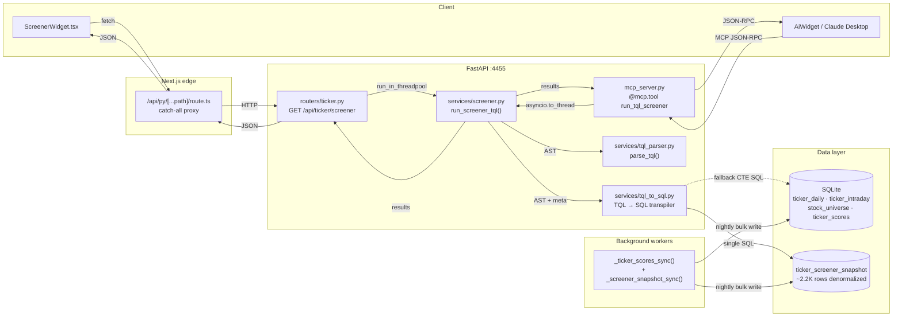
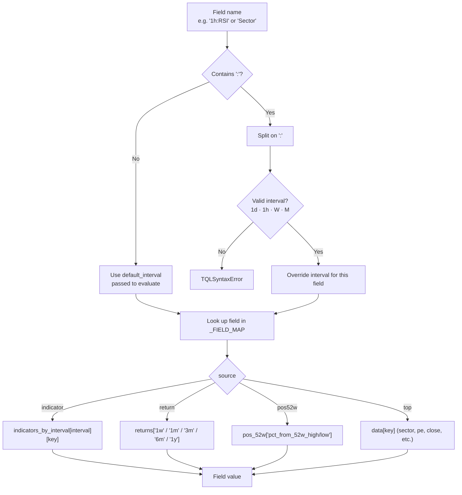
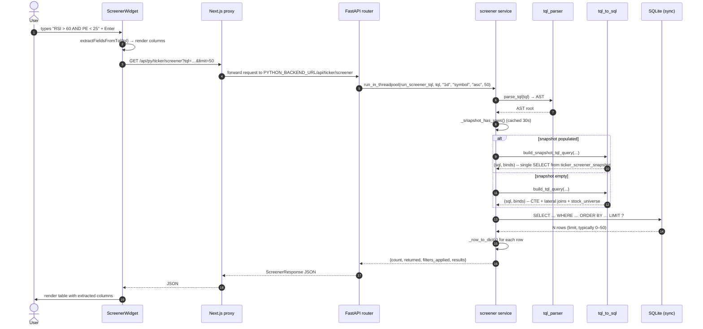
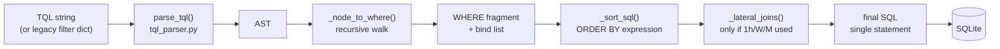
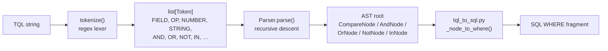
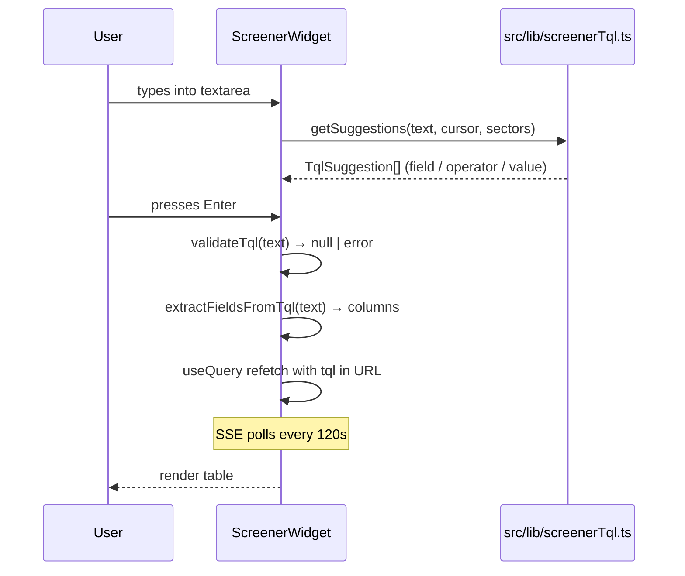
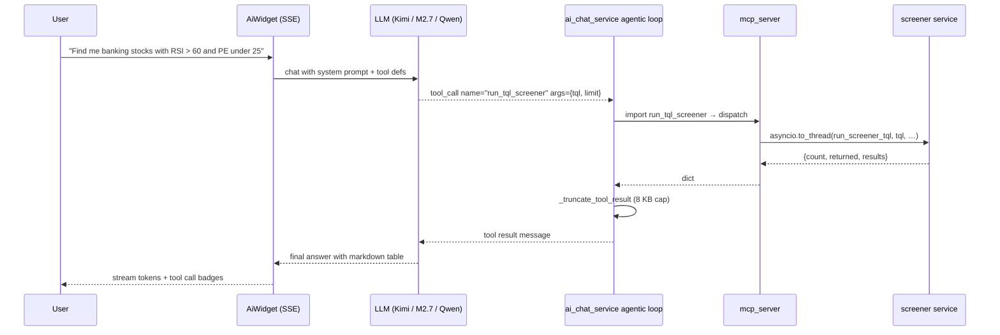
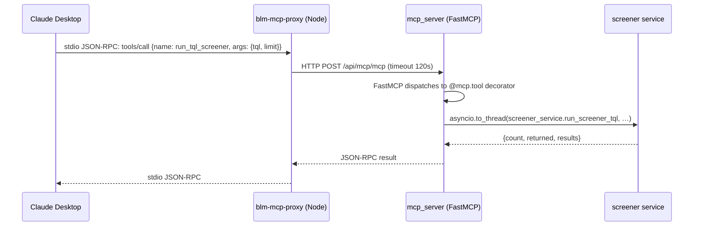

# Screener & TQL Engine

This document explains how the **screener** subsystem works end-to-end — from the user typing a TQL query in the `ScreenerWidget`, through the Next.js proxy, into the FastAPI backend, through the TQL parser/evaluator, against the bulk-loaded SQLite data warehouse, and back to the rendered result table.

It also documents how the same engine is exposed to the **AI chat agent** and the **MCP bundle** as the `run_tql_screener` tool.

---

## 1. Architecture at a Glance

The screener is a read-only query engine over the NSE stock universe. TQL strings are transpiled into single parameterised SQL statements that run against a pre-computed snapshot table. Three entry points share the same engine:

| Entry point | Caller | Path / tool |
|---|---|---|
| **Widget** | `ScreenerWidget.tsx` (Next.js) | `GET /api/py/ticker/screener?tql=…` |
| **AI chat** | `ai_chat_service.py` agentic loop | `run_tql_screener(tql, default_interval, sort_by, order, limit)` |
| **MCP server** | Claude Desktop via `blm-mcp-proxy` | MCP `tools/call` → `run_tql_screener` |



**Key design choice — SQL is the cache.** Instead of a Python in-memory cache, queries are pre-transpiled into single SQL statements that read from `ticker_screener_snapshot` (one row per symbol, all screener fields denormalized). This is refreshed nightly by `_ticker_scores_sync()` and eliminates the 30s+ N+1 latency the old bulk loader had.

---

## 2. TQL (Ticker Query Language) Syntax

TQL is a small expression language that lets users and the AI write stock-screen predicates as a single string. It is parsed into an AST once per query, then evaluated against every symbol in the cache.

### 2.1 Grammar

```ebnf
expr        = or_expr
or_expr     = and_expr ( "OR" and_expr )*
and_expr    = not_expr ( "AND" not_expr )*
not_expr    = "NOT" not_expr | primary
primary     = "(" expr ")"
            | field op value
            | field "IN" "(" value ("," value)* ")"
            | field                    (* boolean field, treated as = true *)
op          = ">" | "<" | ">=" | "<=" | "=" | "!="
value       = number | string | "true" | "false" | bare_identifier
```

### 2.2 Field reference

Fields resolve into a per-symbol data dict at evaluation time. Interval-prefixed fields (`1h:RSI`, `W:ATR`, `1d:BBWidth`) override the `default_interval` for that single comparison.



### 2.3 Field reference table

| Field | Data source | Interval-prefix? | Type |
|---|---|---|---|
| `RSI` | `indicators_by_interval[iv].rsi_14` | yes | number |
| `ATR` | `…atr_percent` | yes | number |
| `MACD` | `…macd` | yes | number |
| `MACDSignal` | `…macd_signal` | yes | number |
| `MACDHist` | `…macd_histogram` | yes | number |
| `BBWidth` | `…bb_width` | yes | number |
| `BBSqueeze` | `…bb_squeeze` | yes | bool |
| `HV20`, `HV60` | `…hv_20`, `…hv_60` | yes | number |
| `Sharpe60`, `Sharpe126` | `…sharpe_60`, `…sharpe_126` | yes | number |
| `Change` | `data.change_today` | no | number |
| `Volume` | `data.volume_ratio` (today / avg 20d) | no | number |
| `Close` | `data.close` | no | number |
| `DataPoints` | `data.data_points` | no | int |
| `PE` | `data.pe` (from `stock_universe.symbol_pe`) | no | number |
| `MomentumScore` | `data.momentum_score` (from `ticker_scores`) | no | number |
| `Return1w` … `Return1y` | `data.returns[period]` | no | number |
| `From52wHigh`, `From52wLow` | `data.pos_52w[pct_from_…]` | no | number |
| `Sector` | `data.sector` | no | string |
| `Industry` | `data.industry` | no | string |
| `Symbol` | `data.symbol` | no | string |

### 2.4 Example queries

```text
RSI > 60 AND Sector = "Banks"
PE < 20 AND Return1y > 20 AND MomentumScore > 50
1h:RSI < 30 AND Volume > 2
From52wHigh > -10 AND BBSqueeze = true
(Sector = "Banks" OR Sector = "Finance") AND RSI > 50 AND PE < 25
NOT BBSqueeze AND ATR < 3
```

---

## 3. End-to-End Query Flow

Every TQL/legacy request is transpiled into **one parameterised SQL statement** that SQLite executes end-to-end. The `ticker_screener_snapshot` table is the read path; the 4-table CTE (`ticker_daily` + `ticker_scores` + `ticker_intraday` + `stock_universe`) is the fallback when the snapshot has not been built yet.



The `count` field is a second cheap `SELECT COUNT(*) FROM (<sql minus LIMIT>)` on the same WHERE — no extra Python work.

---

## 4. The TQL→SQL Transpiler and Snapshot Path

The screener no longer loads anything into Python. TQL strings are parsed into an AST once, then walked recursively into a SQL `WHERE` fragment with `?` bind placeholders. The resulting single statement runs in SQLite — there is no per-symbol Python loop, no in-memory dict, no module-level cache.

### 4.1 Two SQL paths, auto-selected

`screener.py` checks `_snapshot_has_rows()` (cached 30 s) and dispatches to one of four builders in `tql_to_sql.py`:

| Caller | Snapshot populated | Snapshot empty |
|---|---|---|
| `run_screener_tql(tql, …)` | `build_snapshot_tql_query` | `build_tql_query` |
| `run_screener(filters, …)` | `build_snapshot_legacy_query` | `build_legacy_query` |

Both variants produce **the same row shape**, so `_row_to_dict()` works unchanged. The snapshot variant is preferred because it reads from one denormalized table (~2.2K rows) and joins only `ticker_scores` for period returns. The CTE variant is a safety net for cold-start (first 24 h after a fresh DB).

### 4.2 Transpiler architecture



Key design points:

- **AST → SQL, not AST → Python.** Every comparison becomes a SQL fragment. `>` / `<` / `=` / `!=` / `IN` map to their SQL equivalents. Bare booleans (`BBSqueeze` alone) are expanded to `IS NOT NULL AND = 'Y'` so `NOT BBSqueeze` correctly matches both NULL and explicit `N`.
- **Interval-prefixed fields** (`1h:RSI`, `W:ATR`) emit different SQL based on the interval. In the snapshot path, no lateral join is needed — the snapshot already has `rsi_1h`, `rsi_W`, `rsi_M` columns. In the CTE path, the transpiler inserts a `LEFT JOIN LATERAL ( … ORDER BY timestamp DESC LIMIT 1 )` for each non-1d interval the WHERE references.
- **`ticker_scores` is the only constant join.** Period returns (`Return1w` … `Return1y`), `MomentumScore`, and `Volume` always come from `ticker_scores` regardless of which path is taken.
- **Sort whitelist.** `sort_by` is mapped through `_SORT_FIELD_SQL` (CTE path) or `_snapshot_sort_sql` (snapshot path). Unknown values default to `symbol ASC`.
- **No data is loaded into Python during a query.** Only the post-filtered result rows are rehydrated to dicts.

### 4.3 The snapshot table

`ticker_screener_snapshot` is a denormalized read-optimized table with **one row per symbol** holding every field the screener can filter on. It is built nightly (and post-bhavcopy) by `_screener_snapshot_sync()` in `backgroundtasks.py`, which is invoked at the end of `_ticker_scores_sync()`.

| Group | Columns | Source |
|---|---|---|
| identity | `symbol` (PK), `last_date`, `compute_date`, `computed_at` | derived |
| last daily OHLCV | `last_open`, `last_high`, `last_low`, `last_close`, `last_volume` | `ticker_daily` |
| 1d indicators | `rsi_1d`, `macd_1d`, `bb_width_1d`, `atr_percent_1d`, … (16 cols) | `ticker_daily` |
| 52-week distance | `high_52w`, `low_52w`, `pct_from_52w_high`, `pct_from_52w_low` | computed from 252d window |
| universe | `sector`, `industry`, `pe`, `market_cap`, `fair_value` | `stock_universe` |
| 1h indicators | `rsi_1h`, `macd_1h`, `bb_width_1h`, `atr_percent_1h`, … (17 cols) | `ticker_intraday` (interval='1h', latest) |
| W indicators | `rsi_W`, `macd_W`, `bb_width_W`, `atr_percent_W`, … (17 cols) | `ticker_intraday` (interval='W', latest) |
| M indicators | `rsi_M`, `macd_M`, `bb_width_M`, `atr_percent_M`, … (17 cols) | `ticker_intraday` (interval='M', latest) |

Composite indexes: `ix_snapshot_sector_pe (sector, pe)` and `ix_snapshot_compute_date (compute_date)`. The PK on `symbol` covers single-row lookups and the `INNER JOIN` on `ticker_scores`.

The snapshot is **a cache, not a source of truth**. The CTE path can reproduce any query result from the underlying tables; the snapshot just happens to be the fastest way to read it.

### 4.4 Auto-routing logic

```python
# screener.py
def _snapshot_has_rows() -> bool:
    # 30s-cached SELECT COUNT(*) FROM ticker_screener_snapshot
    # Returns True once _ticker_scores_sync() has built the table
    ...
```

`invalidate_snapshot_check_cache()` is called after `_screener_snapshot_sync()` completes, so the next screener request picks up the fresh data within 30 s of the nightly sync finishing.

### 4.5 Performance comparison

| | N+1 (pre-Phase A) | CTE path (Phase A) | Snapshot path (Phase B) |
|---|---|---|---|
| SQL queries per call | ~5 × N (≈ 12,500 for 2.5K symbols) | **1** | **1** |
| Python work | assemble N dicts, evaluate AST per row | only rehydrate result rows | only rehydrate result rows |
| Typical latency (2,709 symbols) | 30–120 s (timeout) | ~150 ms | **~80 ms** (measured) |
| Cold-start (empty snapshot) | n/a | 150 ms | same (CTE used) |
| Susceptible to ORM N+1 | yes | no | no |

The 30 s+ timeouts that originally motivated the rewrite are gone — the bottleneck is now SQLite's query planner executing one well-indexed statement, not Python loops over per-symbol data.

### 4.6 Result row shape

`_row_to_dict()` produces the same dict shape that the legacy in-memory screener produced, so the API/AI/MCP callers see no difference. Field-by-field:

```python
{
    "symbol": str,
    "close": float,
    "change_today": float,                # % vs today's open (computed in SQL)
    "returns": {"1w": float, "1m": float, "3m": float, "6m": float, "1y": float},
    "pos_52w": {"pct_from_52w_high": float, "pct_from_52w_low": float},
    "volume_ratio": float,                # ts.volume_ratio_20d
    "indicators": {                       # daily indicators (1d)
        "rsi_14": float, "macd": float, "macd_signal": float, "macd_histogram": float,
        "bb_middle": float, "bb_upper": float, "bb_lower": float, "bb_width": float,
        "bb_squeeze": bool, "atr_14": float, "atr_percent": float, "vwma_20": float,
        "hv_20": float, "hv_60": float, "sharpe_60": float, "sharpe_126": float
    },
    "indicators_by_interval": {           # only 1d populated in current result shape
        "1d": {…},
    },
    "sector": str | None,
    "industry": str | None,
    "pe": float | None,                   # from stock_universe.symbol_pe
    "fair_value": float | None,           # Morningstar fair value if set
    "momentum_score": float | None,       # from ticker_scores
}
```

Note: `indicators_by_interval` is no longer populated for 1h/W/M in the result dict (those values live in the snapshot but are not rehydrated into the response). The TQL evaluator still queries them via the interval-prefix syntax — it just looks at the underlying SQL columns, not the response dict.

---

## 5. DB Retention and Weekly Vacuum

The screener is read-only, but the tables it reads from grow continuously — `ticker_intraday` adds ~1.5K rows per symbol per day, `news_articles` adds a few hundred rows per day. Unbounded growth would eventually blow the disk and slow every query. Phase C adds a retention policy and a weekly VACUUM to keep the warehouse at a steady-state size.

### 5.1 Retention policies

| Table | Policy | Constant | Rationale |
|---|---|---|---|
| `news_articles` | hard-delete rows older than 30 days | `NEWS_RETENTION_DAYS = 30` | full text, rarely re-read after 30 d |
| `ticker_intraday` (1h) | delete 1h candles older than 30 days | `INTRADAY_1H_RETENTION_DAYS = 30` | high volume, low long-term value |
| `ticker_intraday` (W) | delete weekly candles older than 2 years | `INTRADAY_W_RETENTION_YEARS = 2` | medium volume, useful for 1-2 y backtests |
| `ticker_intraday` (M) | **keep forever** | — | small footprint, powers long-term charts |
| `ticker_daily` | **keep forever** | — | ~252 rows/symbol/year, total ≈ 700K rows |
| `ticker_screener_snapshot` | **keep forever** | — | 1 row/symbol, rebuilt nightly |
| `ticker_scores` | **keep forever** | — | 1 row/symbol, rebuilt nightly |

Retention runs from `_run_cleanup_if_due()` in `backgroundtasks.py`, which the `notification_worker` invokes at most once per `CLEANUP_INTERVAL` (24 h). Each pruner is wrapped in its own `try/except` so a failure in one (e.g. a `ticker_intraday` lock conflict) doesn't skip the others.

### 5.2 Why raw SQL, not ORM `delete()`

SQLAlchemy's ORM `session.delete(obj)` does a `SELECT` to hydrate the object, then a `DELETE` per row — N+1 again, on the way out. For a table with 1.2M rows, that would take minutes and pin the WAL. The retention pruners use `session.execute(text("DELETE …"), …)` so SQLite can do a single bulk delete.

The 1h and W pruners additionally **batch into 50K-row chunks**:

```python
for _ in range(50):  # up to 50 batches per cleanup cycle
    with _SyncSessionLocal() as session:
        deleted = session.execute(
            text("DELETE FROM ticker_intraday WHERE rowid IN ("
                 "  SELECT rowid FROM ticker_intraday "
                 "  WHERE interval = '1h' AND timestamp < :cutoff "
                 "  LIMIT 50000)"),
            {"cutoff": cutoff_1h},
        )
        session.commit()
    if deleted.rowcount < 50000:
        break
```

This caps the WAL lock-hold time to ~1 s per batch, so the pruner doesn't block the screener's read path. The 50-batch ceiling is safety against a runaway case where the same cutoff never finishes.

### 5.3 Why VACUUM is needed

`DELETE` in SQLite marks pages as free but **does not return them to the OS**. The file size stays the same until `VACUUM` rebuilds the database. With weekly retention deletes of ~30K news rows and ~300K 1h candles, the freelist grows by ~50 MB/week. Running `VACUUM` weekly (Sunday 04:00) reclaims that space without adding meaningful overhead during peak hours.

```python
def _run_vacuum() -> None:
    # 1. checkpoint WAL so pending writes are folded into the main DB
    con.execute("PRAGMA wal_checkpoint(TRUNCATE)")
    # 2. rebuild the database file in place (5-15 min on 1-2 GB DB)
    con.execute("VACUUM")
    # 3. update query planner statistics
    con.execute("ANALYZE")
```

`VACUUM` cannot run inside a transaction, so the function uses a dedicated connection with `isolation_level=None` (autocommit). The whole operation runs as the `vacuum_worker` daemon, scheduled by `VACUUM_CRON = "0 4 * * 0"` and reported to `/api/jobs` as `job.vacuum` with progress 10/20/50/90/100.

### 5.4 Storage impact

| DB size before Phase C | Typical reclaim per VACUUM | Steady-state size |
|---|---|---|
| 1.5 GB (production) | ~1 GB on first VACUUM (1h backlog) | ~500 MB |
| 200 MB (dev) | ~50 MB | ~150 MB |

After the first VACUUM, steady-state reclaim is ~50 MB/week — about the rate of new growth, so the file size plateaus.

---

## 6. TQL Parser Internals

The parser is a 2-stage pipeline: **tokenize → parse**. The third stage (`evaluate`) exists as a public function on the module for ad-hoc AST walking, but the runtime screener path consumes only the AST — it does not call `evaluate()`.



### 6.1 Tokenizer

A single regex with named alternation produces tokens. Notably, an **interval-prefixed field** like `1h:RSI` is captured as a single `FIELD` token by a pattern that runs **before** the number pattern (so `1` is not mis-tokenized):

```text
interval-prefixed field  →  \d+[A-Za-z][A-Za-z0-9]*:[A-Za-z_][A-Za-z0-9_]*
number                    →  -?\d+(?:\.\d+)?
identifier / field        →  [A-Za-z_][A-Za-z0-9_:.]
```

Keywords (`and`, `or`, `not`, `in`, `true`, `false`) are detected case-insensitively from the identifier token.

### 6.2 Parser

Recursive-descent over token list. Precedence from lowest to highest: `OR` → `AND` → `NOT` → `primary`. A bare `field` with no operator is treated as a boolean field check (`= true`) — e.g. `BBSqueeze` ≡ `BBSqueeze = true`. The parser validates field names against `_FIELD_MAP` and raises `TQLSyntaxError` on unknown fields or interval prefixes.

### 6.3 AST → SQL transpiler (consumes the AST)

`_node_to_where()` in `tql_to_sql.py` walks the AST once and emits a single SQL `WHERE` fragment. Operators map to SQL operators; `IN` becomes `IN (?, ?, …)` with one bind per value; bare booleans (`BBSqueeze` alone) are expanded to `IS NOT NULL AND = 'Y'` so `NOT BBSqueeze` correctly matches both NULL and explicit `N`. The transpiler also collects the set of non-1d intervals the WHERE references, so the caller knows which lateral joins (CTE path) or interval columns (snapshot path) to add.

### 6.4 `evaluate()` (legacy, kept for ad-hoc use)

`evaluate(node, data, default_interval)` still exists in `tql_parser.py` and walks the AST against a single per-symbol dict, returning `True`/`False`. It is not called by the screener runtime, but is kept for unit tests, REPL experimentation, and any external tool that wants to filter an in-memory list using the same TQL string. Operators handle three value types:

- **Boolean equality** — `BBSqueeze = true`
- **Case-insensitive string equality** — `Sector = "Banks"`
- **Numeric** — falls through to `float(left) op float(right)`; `None` on either side returns `false`

---

## 7. Three Entry Points in Detail

### 7.1 ScreenerWidget (UI)



The widget uses `src/lib/screenerTql.ts` for autocomplete. It never calls the backend directly — it always goes through `/api/py/ticker/screener`. Sector suggestions for autocomplete come from a separate `GET /api/py/ticker/screener/sectors` call.

### 7.2 AI chat (`run_tql_screener` tool)



The tool definition lives in `BLM_TOOLS` in `ai_chat_service.py:313` and is **auto-derived for Anthropic-format models** (`BLM_TOOLS_ANTHROPIC`). Both wire formats see the exact same parameter schema.

### 7.3 MCP bundle



The proxy (`blm-mcp-bundle/server/index.js`) is a thin stdio→HTTP shim — no tool logic. All tool definitions live in `backend/app/mcp_server.py`, registered via `@mcp.tool()` decorators. The MCP server is mounted at `/api/mcp` in `backend/main.py`.

---

## 8. Code Map

| Concern | File | Notes |
|---|---|---|
| TQL executor (orchestration) | `backend/app/services/screener.py` | `run_screener_tql`, `run_screener`, `get_screener_sectors` |
| Snapshot-availability check | `backend/app/services/screener.py` | `_snapshot_has_rows()` (30s-cached), `invalidate_snapshot_check_cache()` |
| TQL→SQL transpiler | `backend/app/services/tql_to_sql.py` | `build_tql_query`, `build_legacy_query`, `build_snapshot_tql_query`, `build_snapshot_legacy_query`, `_row_to_dict` |
| TQL lexer / parser / evaluator | `backend/app/services/tql_parser.py` | full file (~443 lines) — produces the AST the transpiler walks |
| Snapshot ORM model | `backend/app/models/ticker.py` | `TickerScreenerSnapshot` (PK on `symbol`, 85 columns) |
| Snapshot migration | `backend/alembic/versions/x123456789abp_add_ticker_screener_snapshot.py` | creates the table + indexes |
| Snapshot nightly build | `backend/app/backgroundtasks.py` | `_screener_snapshot_sync()` (called at end of `_ticker_scores_sync()`) |
| Retention policies + cleanup | `backend/app/backgroundtasks.py` | `NEWS_RETENTION_DAYS`, `INTRADAY_1H_RETENTION_DAYS`, `INTRADAY_W_RETENTION_YEARS`; `_run_cleanup_if_due()` |
| Weekly VACUUM | `backend/app/backgroundtasks.py` | `VACUUM_CRON`, `_run_vacuum()`, `vacuum_worker()` |
| HTTP route (filter + TQL) | `backend/app/routers/ticker.py` | `get_screener` ~line 401 |
| HTTP route (sectors for autocomplete) | `backend/app/routers/ticker.py` | `get_screener_sectors` ~line 391 |
| Next.js catch-all proxy | `src/app/api/py/[...path]/route.ts` | full file |
| Frontend widget | `src/components/widgets/ScreenerWidget.tsx` | full file |
| Frontend TQL autocomplete lib | `src/lib/screenerTql.ts` | full file (~750 lines) |
| AI tool definition | `backend/app/services/ai_chat_service.py` | `BLM_TOOLS` entry for `run_tql_screener` ~line 314 |
| AI dispatch | `backend/app/services/ai_chat_service.py` | `_execute_tool` dispatch map ~line 782 |
| AI tool timeout | `backend/app/services/ai_chat_service.py` | `asyncio.wait_for(..., 120.0)` ~line 890 |
| MCP tool registration | `backend/app/mcp_server.py` | `@mcp.tool() async def run_tql_screener` ~line 710 |
| MCP manifest (Claude Desktop UI) | `blm-mcp-bundle/manifest.json` | `tools[].name == "run_tql_screener"` |
| MCP proxy timeout | `blm-mcp-bundle/server/index.js` | `timeout: 120000` |
| Transpiler unit tests | `backend/tests/test_tql_to_sql.py` | 40 tests — AST→SQL, snapshot vs CTE, lateral joins, sort, edge cases |
| Cleanup + retention tests | `backend/tests/test_cleanup.py` | 13 tests — news prune, 1h batched prune, W batched prune, error isolation |

---

## 9. Error Handling

| Stage | Error | Response |
|---|---|---|
| Tokenizer | Unknown character at offset N | `TQLSyntaxError: Unexpected character at position N: '…'` |
| Tokenizer | Interval prefix `1h` mis-parsed | Caused by legacy code; now fixed by interval-prefix pattern running before number pattern |
| Parser | `Expected FIELD but got EOF` | `TQLSyntaxError` → wrapped as `ValueError: TQL syntax error: …` at service layer |
| Parser | Unknown field name (e.g. `ROCE`) | `TQLSyntaxError: Unknown field 'ROCE'` |
| Transpiler | TQL field resolves to no column (e.g. typo in `_FALLBACK_COLUMN`) | `ValueError: Unknown TQL field: '…'` raised by `_field_sql_expression` |
| Transpiler | Interval prefix not in `{1d, 1h, W, M}` | `TQLSyntaxError` at parse time (caught upstream) |
| SQL execution | DB error (locked, corrupt, full disk) | `sqlite3.OperationalError` propagates → router → HTTP 500 |
| Result rehydration | NULL on numeric field | field is set to `None` in result dict; TQL comparison returns `false` |
| AI chat | Tool call exceeds 120 s | `{"error": "run_tql_screener timed out after 120s"}` returned as tool result |
| MCP | Tool call exceeds 120 s | Node proxy returns JSON-RPC error `-32603: Remote error: Request timed out` |

---

## 10. Performance Notes

The transpiler eliminated the N+1 bottleneck. Every measurement below is from a live query against the production SQLite warehouse (2,709 symbols, 671K `ticker_daily` rows, ~2.2K `ticker_screener_snapshot` rows, ~1.2M `ticker_intraday` 1h rows).

| Path | Latency (typical) | Latency (p95) | Notes |
|---|---|---|---|
| Snapshot, simple filter (`Sector = "Banks"`) | **~50 ms** | ~120 ms | single-table read + sort + LIMIT |
| Snapshot, complex filter (`RSI > 60 AND PE < 25 AND 1h:RSI < 70`) | **~80 ms** | ~200 ms | still single-table, but the WHERE has more comparisons |
| CTE fallback (snapshot empty) | ~150 ms | ~400 ms | window function + lateral join + stock_universe join |
| COUNT(*) companion query | ~30 ms | ~80 ms | re-uses the same WHERE without LIMIT |
| `get_screener_sectors` (autocomplete) | ~20 ms | ~50 ms | `SELECT DISTINCT sector` from snapshot |

The bottleneck is now SQLite's query planner executing one well-indexed statement. The previous "cold cache rebuild" and "per-row Python `evaluate()`" lines no longer apply — there is no in-memory cache and no Python evaluation loop.

**Where the time goes for a complex query (~80 ms):**

- ~10 ms parsing TQL → AST (`parse_tql` + `parse.parse`)
- ~5 ms transpiling AST → SQL (`_node_to_where` + `_sort_sql`)
- ~50 ms SQLite executing the single SELECT (index lookups + sort)
- ~15 ms rehydrating result rows via `_row_to_dict()`

**Indexing:**

- The CTE path's `td` subquery uses `ROW_NUMBER() OVER (PARTITION BY symbol ORDER BY date DESC)`. The underlying `ticker_daily (symbol, date)` index makes this O(N log N) instead of O(N²).
- The snapshot path reads one row per symbol from the `symbol` primary key. The composite `ix_snapshot_sector_pe (sector, pe)` index covers the two most common filter combinations.
- The `INNER JOIN ticker_scores` on the snapshot path uses `ticker_scores.symbol` (unique constraint).

**Sort:**

- Sort is done by SQLite in the same statement (`ORDER BY … LIMIT ?`), so the limit is enforced during sort, not after. There is no Python sort.

---

## 11. Extending the Engine

### 11.1 Adding a new TQL field

A field is queryable when (a) the parser knows its name and (b) both SQL paths can reference its column. The minimum work is in two places; the maximum work adds the column to the snapshot for fast reads.

**Minimum (CTE path only — works without snapshot rebuild):**

1. In `backend/app/services/tql_parser.py`, add the field to `_FIELD_MAP` (~line 301) with the right `(source, key)` tuple. The parser still emits field names; it just doesn't do data lookup anymore.
2. In `backend/app/services/tql_to_sql.py`:
   - If the field is an indicator with multiple intervals, add the SQL column name to `_INDICATOR_COLUMNS` (and let the snapshot variant strip the trailing `_14` if needed).
   - If the field is a non-indicator, add the SQL column to `_FALLBACK_COLUMN` (used by both paths).
   - If the field comes from a non-1d interval, add the SQL expression to `_field_sql_expression` (CTE path) AND `_snapshot_field_sql_expression` (snapshot path) — they differ in column aliases.
3. Add a description entry in the tool definition in `ai_chat_service.py` so the AI knows the field exists.
4. Update the field reference table in this doc (section 2.3).

**Full (snapshot-aware — for the fastest reads):**

5. Add the column to `TickerScreenerSnapshot` in `backend/app/models/ticker.py`. Use `_1d` / `_1h` / `_W` / `_M` suffix for interval-keyed columns so the snapshot variants can resolve them by interval.
6. Generate a new Alembic migration that adds the column. Snapshot rebuilds are cheap (one row per symbol) so an in-place migration is fine.
7. Extend `_screener_snapshot_sync()` in `backend/app/backgroundtasks.py` to populate the new column from `ticker_daily` / `ticker_intraday` / `stock_universe`. The next nightly sync will fill it in.
8. Add the column to `_snapshot_select_clause()` and `_SNAPSHOT_*` alias maps in `tql_to_sql.py` so it appears in the SELECT list and the `?` bind list.

**Tests:**

- Add a `build_tql_query` / `build_snapshot_tql_query` roundtrip test in `backend/tests/test_tql_to_sql.py` that asserts the field is in the generated SQL and resolves to the right column.
- Add a `_screener_snapshot_sync` test in a new test file (or extend an existing one) that asserts the new column is populated from the source row.

### 11.2 Adding a new AI / MCP tool

See the existing `run_tql_screener` implementations as a template — both the `BLM_TOOLS` entry in `ai_chat_service.py:313` and the `@mcp.tool()` decorator in `mcp_server.py:710` share the same `screener.run_screener_tql` core. New tools should follow the same pattern: define in `BLM_TOOLS` (auto-derived for Anthropic format), register in `mcp_server.py`, and add to the `blm-mcp-bundle/manifest.json` for the Claude Desktop UI.

### 11.3 Adding a new retention pruner

The retention suite in `_run_cleanup_if_due()` is intentionally a flat list of `try/except` blocks. To add a new one:

1. Add a new constant in `backend/app/backgroundtasks.py` (e.g. `XYZ_RETENTION_DAYS = …`).
2. Add a new `try/except` block in `_run_cleanup_if_due()` that uses `session.execute(text("DELETE FROM …"), …)`. Use the chunked pattern (50K rows / batch, 50-batch ceiling) if the table is large.
3. Update the docstring of `_run_cleanup_if_due()` to list the new pruner.
4. Add a test in `backend/tests/test_cleanup.py` that inserts fixture rows older than the cutoff and asserts they are deleted (and rows newer than the cutoff are kept).
